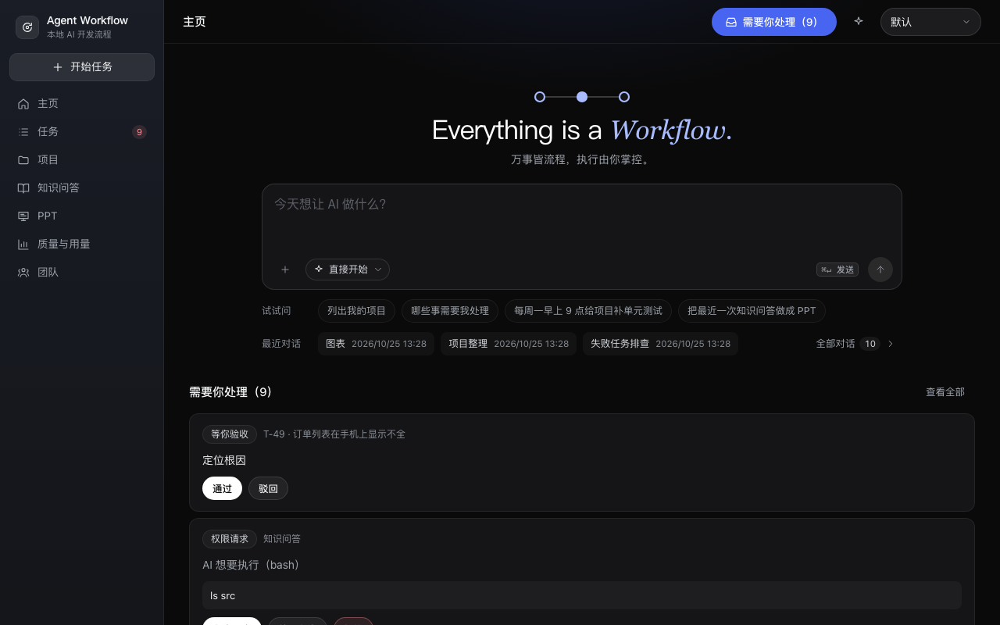
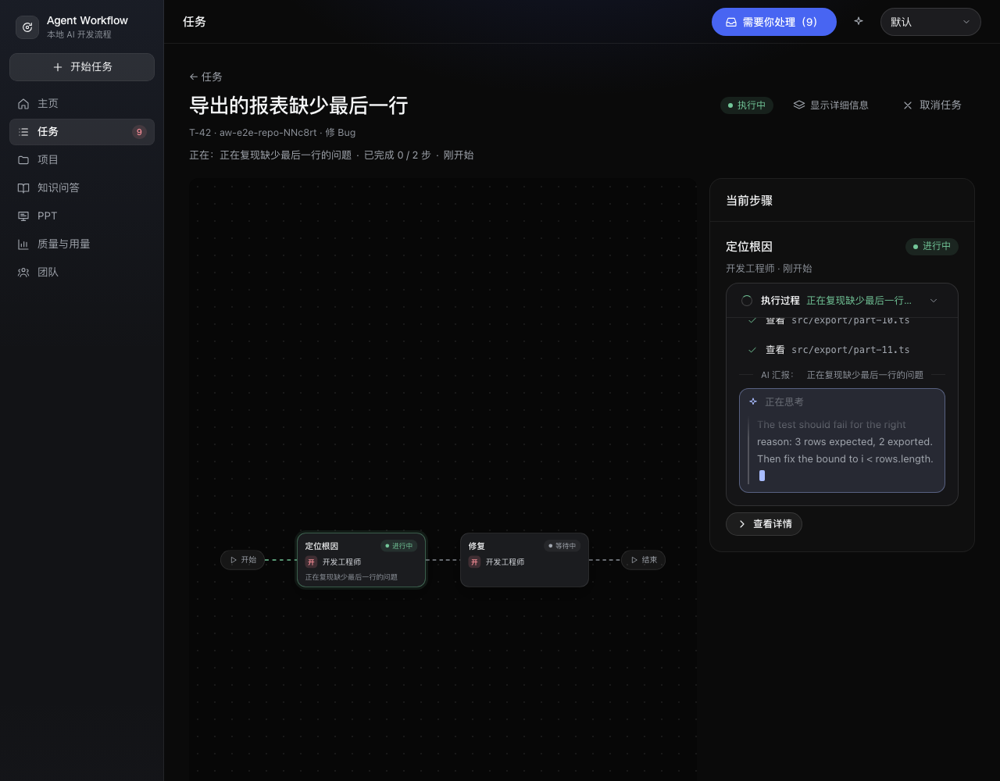
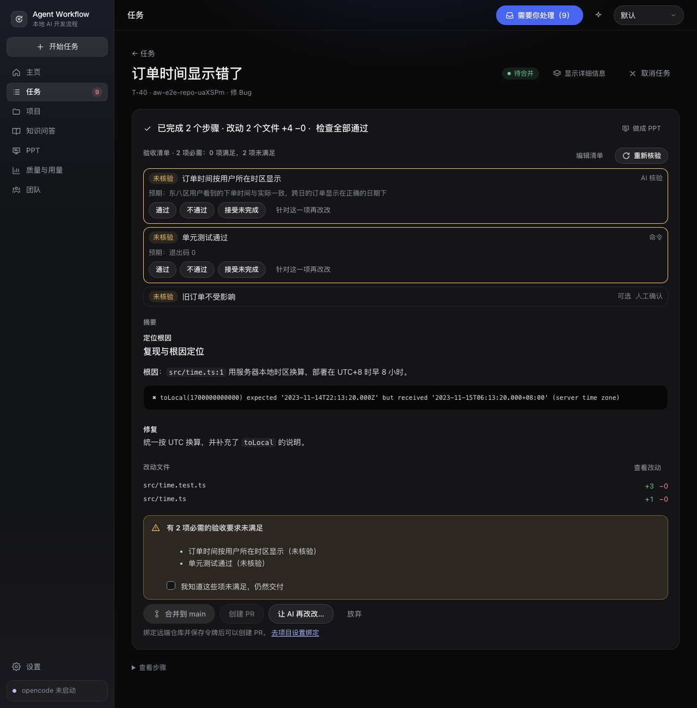

<div align="center">

# Agent Workflow

**Local-first AI coding workflows. Isolated Git worktrees. You decide what gets merged.**

[简体中文](README.md) · **English**

[](https://github.com/wangyufengsky/agent-workflow/releases/latest)

[](LICENSE)

[Download](https://github.com/wangyufengsky/agent-workflow/releases/latest) · [Quick start](#quick-start) · [Screenshots](#screenshots) · [Development](#development)

</div>

Agent Workflow is an open-source desktop application for running AI-assisted software development with [opencode](https://opencode.ai). Choose a repository, pick a workflow, and describe a task. Follow the plan, inspect the changes and checks, then merge locally or create a GitHub pull request / GitLab merge request.

Each task gets its own branch and Git worktree. Tasks can run in parallel without editing your main working directory, and merging always requires your action.



*The screenshots show the project's existing Chinese-language interface. This English guide does not imply an English UI.*

## Why Agent Workflow?

- **A visible coding workflow:** follow planning, implementation, tests, and review on a step-by-step canvas.
- **Separate workspaces:** each task runs in an isolated branch and worktree; review its diff before delivery.
- **Human-controlled delivery:** merge, create a PR/MR, ask the AI to revise, or discard the result. There is no automatic merge.
- **One place for interruptions:** questions, command permissions, plan approvals, and failed tasks appear in the attention queue.
- **Start simple, customize when needed:** professional mode adds editable plans, workflow composition, roles, and a Git workbench.
- **Bring your model provider:** use providers authenticated through opencode. Provider usage may incur charges.

The app and its task data run locally. **Local-first does not mean offline inference:** model calls send relevant context to your configured provider. Optional hosting and network features contact their respective services.

## What can it do?

| Area | Capabilities |
| --- | --- |
| Coding workflows | 11 built-in workflows: features, bug fixes, unit tests, code review, refactoring, version comparison review, security review, warning cleanup, solution design, detailed design, and requirements breakdown. Review and design workflows are read-only. |
| Verification | Project checks such as tests and lint, AI review, acceptance checklists, and optional browser-based page checks. Inspect the results before merging. |
| Parallel work | Independent tasks, batch runs, scheduled workflows, and larger initiatives split into stages and work packages. Scheduled execution still leaves merging to you. |
| Delivery | File diffs, local merge strategies, GitHub PRs / GitLab MRs, and a feedback loop for selected review comments. |
| Browser preview | Start a preview in a task's worktree; inspect the same page the AI uses, with desktop, tablet, and phone sizes. |
| Project knowledge | Read-only questions about code, documents, and linked databases, with citations. Web search is separately controlled and off by default. |
| Assistant and documents | Use the in-app assistant, work with Word / Excel files, and create presentations for PowerPoint or PDF export. |
| Professional mode | Custom workflows and roles, plan editing, a Git workbench, read-only database access for AI, and usage / quality views. |

See the [Chinese user guide](README.md#使用指南) and [design documentation](docs/README.md) for the full feature set and operating details.

## Screenshots

These are existing repository screenshots, reused without altering the interface or displayed results. They illustrate the UI, not a new live-model test or a guarantee that a task has passed verification.

### Follow the task as it runs

The workflow canvas shows the steps; the side panel shows the current execution and report.



### Review before delivery

Inspect the summary, changed files, and acceptance criteria before merging. In this example, acceptance items are still unverified and the delivery warning remains visible.



[More screenshots: assistant, plan editor, initiatives, knowledge answers, presentations, and themes](README.md#界面导览).

## Download

Use [GitHub Releases](https://github.com/wangyufengsky/agent-workflow/releases/latest) for the latest stable packages and `SHA256SUMS.txt`.

| Platform | Availability |
| --- | --- |
| macOS, Apple silicon | Stable `.dmg` |
| Linux x64 / arm64 | Stable `.deb` and `.AppImage` |
| Windows 10 / 11 x64 | [Unsigned preview v1.4.37-beta.1](https://github.com/wangyufengsky/agent-workflow/releases/tag/v1.4.37-beta.1), not the stable release |

Packages are unsigned. Check the release source and checksum before installation. Windows CI covers builds, automated tests, and installed-app startup / shutdown; full real-model workflows and enterprise-network / credential behavior on physical Windows desktops remain to be validated. See [platform support and validation](docs/17-cross-platform.md).

Verify downloaded files against the checksum file from the same release:

```bash
# Linux
sha256sum -c SHA256SUMS.txt --ignore-missing

# macOS: print the package hash, then compare it with SHA256SUMS.txt
shasum -a 256 <downloaded-package.dmg>
```

Platform-specific installation and troubleshooting are in the [Chinese installation guide](README.md#安装). Linux `.deb` is recommended for Ubuntu / Debian; AppImage requires FUSE 2 and may need distribution-specific sandbox configuration.

## Quick start

### 1. Prepare Git and opencode

Install Git and a supported stable opencode version: **1.18.0 through 1.90.x**. This project recommends **1.19.0**, the version used for its build and tests. Prerelease opencode versions are not supported.

```bash
npm install -g opencode-ai@1.19.0
opencode auth login
```

Authenticate with at least one model provider. On Windows, use the full Git for Windows installation, including Git Bash.

### 2. Open the app and add a project

The first-run checks cover Git, opencode, available models, and credential storage. Add a local repository directory. Adding an unversioned directory can initialize Git, create a `.gitignore`, and make an initial commit.

The app infers project check commands, which you can adjust in project settings. On Linux, credentials use a supported system key service when available; an encrypted store protected by a master password is available otherwise.

### 3. Run a small task

Choose **直接开始** (Start directly), select a workflow such as **修 Bug** (Fix a bug), and describe a focused change. Optionally add attachments, acceptance requirements, or require plan approval before execution.

For example: “Fix the order timestamp so it displays in the user's time zone, and add a regression test.”

### 4. Inspect and deliver

Answer questions and permission requests in **需要你处理** (Needs your attention). Review the diff, checks, and acceptance requirements when the task finishes. Then choose **合并到 main** (Merge into main), **创建 PR** (Create PR), or **让 AI 再改改** (Ask AI to revise).

Creating a PR/MR requires a GitHub / GitLab remote and a configured hosting token. Do not paste credentials into assistant conversations; use the application's credential forms.

## Development

Requirements: macOS arm64 or Linux, **Node.js 24.19+ within the 24.x line**, **pnpm 10.28.0**, Git, and supported opencode.

```bash
git clone https://github.com/wangyufengsky/agent-workflow.git
cd agent-workflow
corepack enable
pnpm install
pnpm dev
```

| Command | Purpose |
| --- | --- |
| `pnpm dev` | Start the Electron app in development mode |
| `pnpm verify` | Type checks, lint, dependency / CSS / state-machine checks, unit and integration tests, and build |
| `pnpm e2e` | Browser E2E tests using FakeOpencode; walkthrough screenshots are written to `screenshots/walkthrough/` |
| `pnpm e2e:smoke` | Electron startup smoke test after `pnpm build`; no opencode required |
| `pnpm test:oc` | Integration tests with real opencode |
| `pnpm test:live` | Manual workflow tests with a real model; provider charges may apply |
| `pnpm dist` | Build unsigned installers for the current platform |

Database integration tests require Docker and `mysql:8.4`. Additional database images are optional; see the [testing standards](docs/07-testing-standards.md). FakeOpencode tests and screenshots are not evidence of real-model task success.

### Architecture

- **Desktop:** Electron main process in `apps/desktop`, with a backend utility process.
- **Backend:** Fastify and SQLite in `packages/server`, listening on `127.0.0.1`, with a managed `opencode serve` process.
- **Frontend:** React 19, TanStack Query, and React Flow in `apps/web`.
- **Shared contracts:** enums, errors, state machines, and operations in `packages/shared`.
- **Built-ins:** workflows, roles, and composition templates in `packages/builtin`.

Before contributing, read [AGENTS.md](AGENTS.md), [coding standards](docs/06-coding-standards.md), and [testing standards](docs/07-testing-standards.md). Most development documentation is currently in Chinese.

## License

The code is licensed under [Apache-2.0](LICENSE).

**Asset exception:** the temporary whale companion assets in `apps/web/public/companion/whale/` come from [PC2005-cloud/dsh-pet](https://github.com/PC2005-cloud/dsh-pet). They are not covered by Apache-2.0: their terms allow open-source use, prohibit commercial use, and require attribution. See [NOTICE](NOTICE).
