<div align="center">

# Agent Workflow

**Everything is a *Workflow.*　万事皆流程，执行由你掌控。**

一个本地桌面应用：选项目、选流程、写一句需求，AI 在独立的 Git 分支里把活干完，你看结果、点合并。

[](https://github.com/wangyufengsky/agent-workflow/releases/latest)

[](LICENSE)

</div>


---

## 目录

- [它是做什么的](#它是做什么的)
- [功能一览](#功能一览)
- [界面导览](#界面导览)
- [使用指南](#使用指南)
- [安装](#安装)
- [常见问题](#常见问题)
- [从源码运行与参与开发](#从源码运行与参与开发)
- [许可](#许可)

## 它是做什么的

Agent Workflow 把「让 AI 写代码」变成一条看得见、停得住、由你拍板的流水线：

```
选项目 ──► 选流程 ──► 写一句需求 ──► AI 规划并逐步执行 ──► 你看结果 ──► 合并 / 创建 PR / 让 AI 再改改
                                        │
                                        └─ 遇到不确定、需要权限或失败时，才来「需要你处理」找你
```

几个核心约定：

- **每个任务一个独立分支 + 独立 worktree**。多个任务可以同时跑，互不干扰，也不碰你正在用的主工作区。
- **合并永远由你来点**。没有自动合并，这是全自动执行唯一的安全底线。
- **只在必须时打扰你**：AI 的提问、命令权限请求、失败重试，全部汇总到「需要你处理」。
- **默认简单，专业可选**。简单模式只显示结果和必要的打扰；打开「专业模式」后可以编辑计划、编排流程、管理角色、使用 Git 工作台等。
- **完全在本地运行**。代码不离开你的电脑（模型调用除外），AI 由应用托管的 [opencode](https://opencode.ai) 驱动，用你自己登录的模型。

## 功能一览

### 写代码：任务

| 功能 | 说明 |
| --- | --- |
| **11 个内置流程** | 新功能开发、修 Bug、补单元测试、代码审查、重构、版本比对审查、安全审查、清理告警、方案设计、详细设计、需求拆解。审查类与设计类流程只读，不改代码。 |
| **进度画布** | 任务页以画布展示 AI 规划出的步骤，节点依次亮起；右侧实时显示当前步骤的执行过程、AI 的思考与汇报。 |
| **自动检查** | 每一步完成后自动验收：运行项目的检查命令（测试、lint 等）、AI 评审，前端项目还可以做页面体检。 |
| **需求验收清单** | 可以给任务写几条验收要求，最后由只读的核验步骤逐项给出结论；结果卡逐项显示，交付前提醒未满足的项。 |
| **附件** | 开始任务、问助手、「让 AI 再改改」时可以带上文本文件、Word / Excel 或项目里的文件快照，之后每一步看到的都是同一份内容；Excel 大表由 AI 按需读取与汇总。 |
| **项目的 AGENTS.md** | 项目详情里查看默认分支上的 AGENTS.md；「让 AI 生成 / 补充」会开一个任务，AI 梳理项目的命令、结构与约定后写好它，可选加入一节「在 Agent Workflow 中工作」的规则，你看过改动再合并。 |
| **结果卡** | 改动摘要、改了哪些文件、diff、检查结果；按钮：「合并到 main」「创建 PR」「让 AI 再改改」「放弃」。 |
| **合并与冲突** | 默认 squash 合并到目标分支；有冲突时可以交给 AI 解决后再合并。专业模式可选 merge / squash / rebase。 |
| **GitHub / GitLab** | 推送分支并创建 PR / MR；同事在 PR 上留的审查意见可以取回来，勾选后「让 AI 按意见再改改」，再推送回同一个 PR。 |
| **页面预览** | 任务的 worktree 可以起一个页面预览：AI 在内置浏览器里打开、点击、读页面自检；你在任务页的「预览」页签直接看到并操作同一个页面（桌面 / 平板 / 手机尺寸）。 |
| **重启不丢** | 关闭应用时还在执行的任务，重新打开后会继续。 |

### 更大的事：一次开很多任务

| 功能 | 说明 |
| --- | --- |
| **需求计划** | 一份大需求由 AI 拆成若干阶段与工作包（「让 AI 拆解」），你确认后每个工作包作为普通任务运行，合入后自动解锁下游；阶段之间可以让 AI 按合入后的代码细化剩余工作包。 |
| **组合模板** | 把几个小流程按阶段预先排好，写一句需求就开始。内置：设计后开发、详细设计后开发、开发后审查、先补测试再重构；专业模式可以自定义。 |
| **批量任务** | 用一个固定流程一次对多个目标各开一个任务，例如一次给 5 个模块补单元测试，之后集中查看、批量合并。 |
| **定时任务** | 按计划自动运行固定流程，例如每晚补单测、每周一检查依赖。结果进入「需要你处理」等你确认，合并仍然由你来点。 |

### 不写代码也有用

| 功能 | 说明 |
| --- | --- |
| **应用助手** | 主页的大输入框和任意页面的 `⌘J` 浮层。用自然语言让助手调用应用的各项功能（加项目、开任务、查状态、改设置、查数据库、看 Git……），还能画柱状图、饼图和流程图。写操作会弹出确认卡片，合并、取消、删除每次都要确认；密码与令牌只在表单里输入，不经过对话。 |
| **知识问答** | 针对一个项目提问（「退款金额在哪里四舍五入？」），只读的知识研究员去查代码、文档和关联数据库，给出**带引用的回答**，点开引用编号就是原文。网络检索单独开关，默认关闭。 |
| **PPT 制作** | 把任务结果、知识问答或你给的材料做成一份 PPT：AI 先出大纲，确认后逐页制作；可以放映、逐页让 AI 改、自己改文字，最后导出 PDF 或 PowerPoint。 |
| **质量与用量** | 简单模式在任务页顶部看本周三个数；专业模式看 tokens 用量、趋势、按项目 / 流程 / 模型拆分，以及完成率、首次通过率、平均重试、到待合并耗时等质量指标。 |
| **团队** | 按项目看成员这段时间的提交、改动与质量信号，按时间纵向对比、成员之间横向对比，并可让 AI 给出成员的工作总结。不打分、不排名。 |
| **桌面伙伴** | 可选的助手形象（光球或鲸鱼），能以透明小窗常驻桌面：点它就能对话，任务准备好、完成或失败时主动提醒。 |

PPT、质量与用量、团队在专业模式的侧栏里；简单模式下从任务结果卡、知识问答和助手进入同样的页面。助手还能生成与修改 Word / Excel 文件，卡片上可以预览、另存为、用默认应用打开。

应用内置一组 skill（AI 的操作经验，按需加载）：助手在建任务与需求计划、排查失败的任务、安排定时任务、处理 Word / Excel、画图、预览页面和查数据库时用；任务里的 AI 在查数据库、内网环境、解决合并冲突和检查页面时用。你自己或项目里装的 skill（如 `~/.claude/skills`、项目的 `.claude/skills`）在应用里不会加载。

### 专业模式（设置中开启）

| 功能 | 说明 |
| --- | --- |
| **计划编辑** | 运行前在画布上增删步骤、改依赖、改角色与指令、改验收方式；执行中暂停 → 调整未执行的步骤 → 继续；单步重跑、跳过、人工验收。 |
| **流程编排器** | 自定义流程：固定步骤，或 AI 规划 + 约束（规划指引、必经步骤）；可以把别的固定流程的步骤插进来。 |
| **角色** | 4 个内置角色（规划师、开发工程师、测试工程师、评审员），可复制后自定义提示词与模型。 |
| **Git 工作台** | 在主工作区里暂存、提交、推送、拉取，建 / 切 / 删分支，查看提交与 diff、浏览文件、worktree 总览，合并（冲突可交给 AI），以及 AI 只读审查改动。 |
| **数据库** | 连接 MySQL、PostgreSQL、openGauss / GaussDB、SQL Server、GoldenDB，浏览表结构；关联到项目后，AI 可以只读查询。 |
| **系统** | 运行环境（opencode 状态、日志、重启）、MCP 工具清单、存储空间统计与清理旧日志。 |

### 外观

五套主题一键切换，也可以跟随系统：

| 默认 | Claude Code | Codex | DeepSeek | Dracula |
| --- | --- | --- | --- | --- |
| 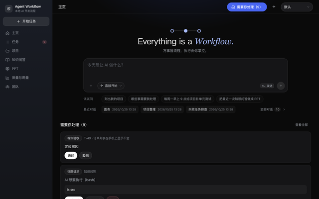 | 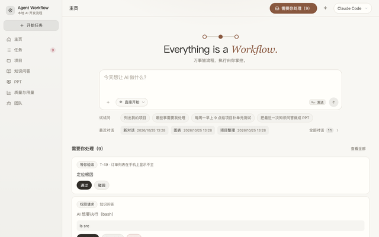 | 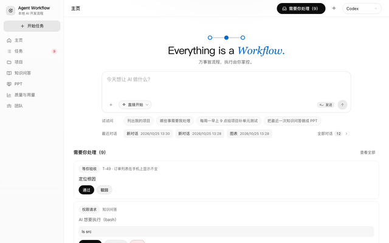 | 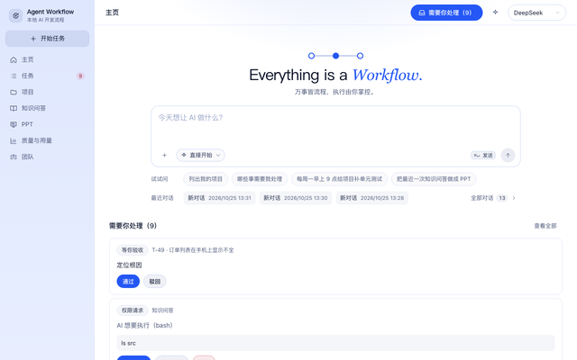 | 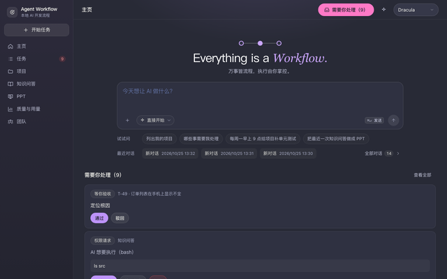 |

## 界面导览

### 主页与助手

主页只有一个输入框：直接打字是问助手；点「直接开始」选一个流程，就切换成「开始任务」，`⌘↵` 或点发送即建任务。下方是三段：「需要你处理」、进行中（需求计划与批量任务各占一行）、待合并。简单模式只放 5 个常用流程，其余在「更多流程」里。

助手对话里的写操作会以确认卡片出现，可以「确认」「确认并总是允许」或「取消」；右侧「工作概览」随时显示待处理与进行中的工作。

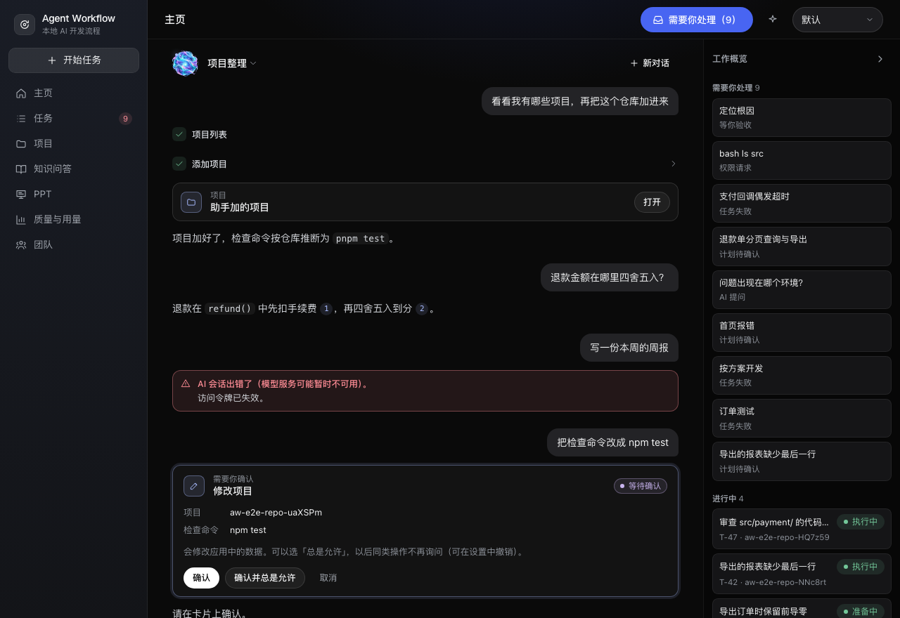

### 任务执行中

左边是步骤画布，右边是当前步骤的执行过程：读了哪些文件、跑了什么命令、AI 在想什么。顶部一行写着「正在做什么、完成几步」。

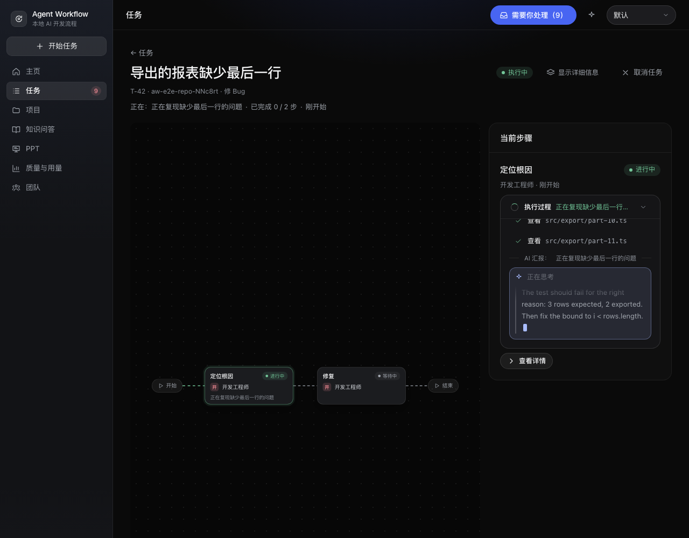

### AI 需要你回答

AI 遇到拿不准的事会提问，给出选项也可以自由回答；回答后任务在原来的会话里接着干。权限请求（例如要执行某条命令）可以「允许一次」「总是允许」或「拒绝」。

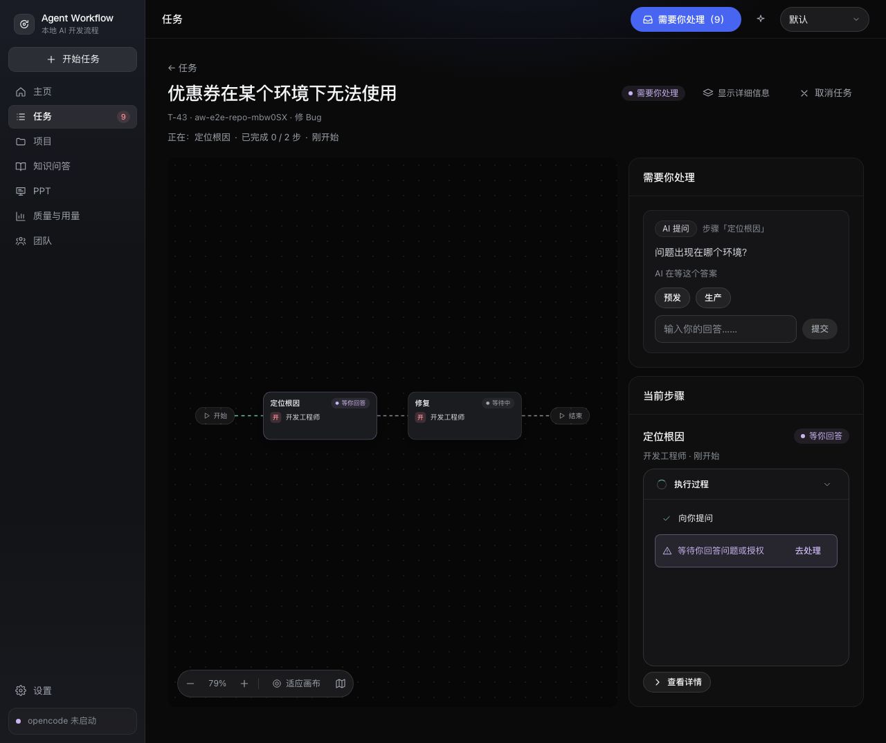

### 结果卡

做完后显示验收清单的逐项结论、每一步的摘要、改动文件与检查结果。确认没问题就「合并到 main」或「创建 PR」；不满意就「让 AI 再改改」，写一句要改什么。

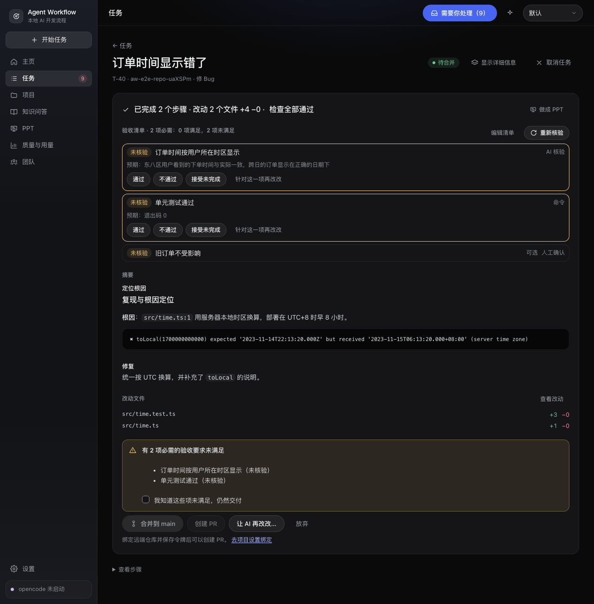

### 编辑计划（专业模式）

勾选「运行前让我确认计划」，或在专业模式下，AI 规划好的步骤会先停下来等你调整：增删步骤、改角色、改指令、改依赖与检查，校验通过后再执行。

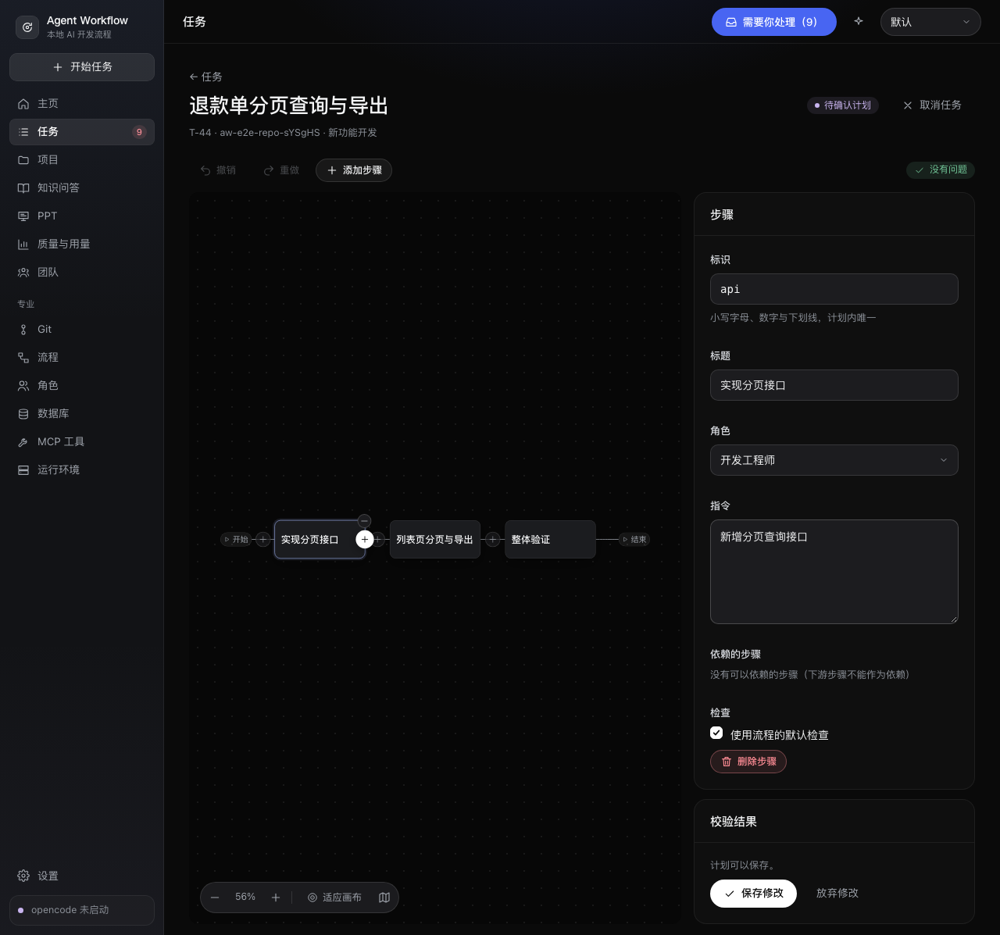

### 需求计划

大需求拆成阶段与工作包，每个工作包就是一个普通任务。确认后第 1 阶段马上开始，前面的合入后下一阶段自动开始；没开始的工作包随时可以修改或标记「不做这一项」。

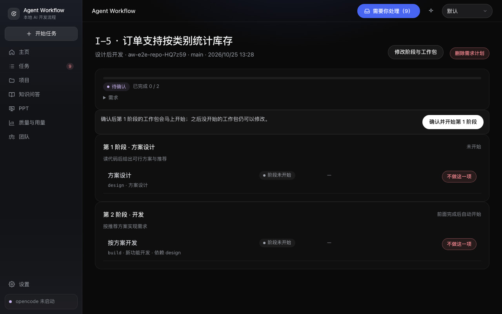

### 知识问答

回答里的每个结论后面都有引用编号，右侧直接打开原文并定位到行。

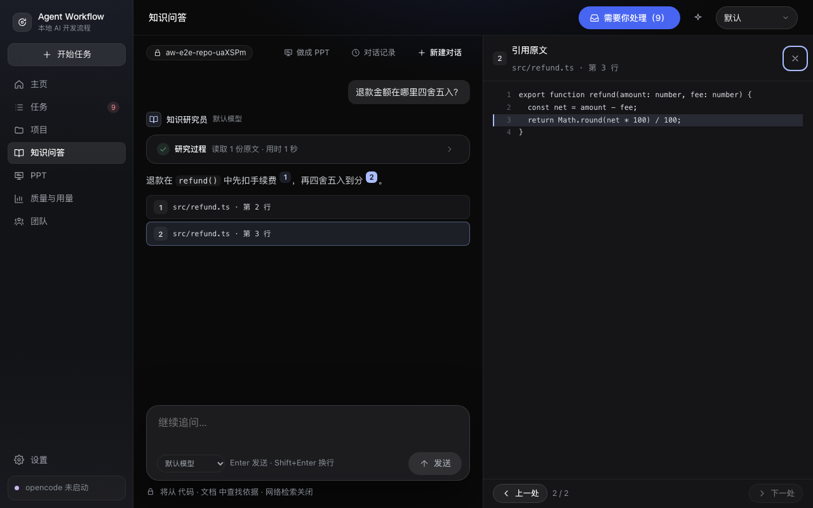

### PPT

左侧逐页缩略图，中间预览，右侧改标题、副标题、讲稿，或让 AI 改本页 / 全部页。可以放映，也能导出 PowerPoint 与 PDF。

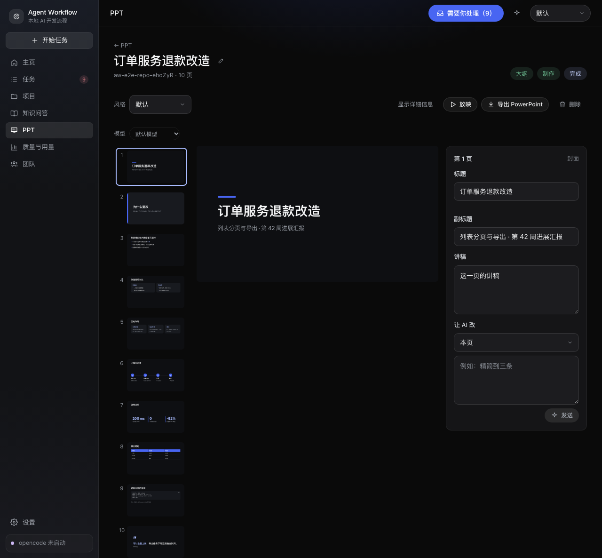

## 使用指南

### 1. 首次启动

第一次打开是环境检测页，依次检查：

| 检查项 | 通过条件 | 没通过时 |
| --- | --- | --- |
| Git | 已安装 | 页面给出本平台的安装命令 |
| opencode | 已安装，版本在 **1.18.0 – 1.90.x** 之间 | 给出安装命令，如 `npm install -g opencode-ai@1.19.0` |
| 可用的模型 | 至少一个模型可用 | 在终端运行 `opencode auth login` 登录模型提供方，再点「重新检测」 |
| 凭据存储 | 系统钥匙串可用，或已设置并解锁主密码（Linux） | 不影响其他功能，只是无法保存托管平台令牌与数据库密码 |

前三项通过后，填入一个本地仓库的目录，点「添加项目」即可开始。**还没有用 Git 管理的目录也可以**，添加时会帮你初始化 Git（生成 `.gitignore` 并做一次首次提交）。应用会按仓库推断检查命令（例如 `pnpm test`），之后可以在项目页修改。

### 2. 开始一个任务

1. 在主页输入框下方点「直接开始」，选一个流程（例如「修 Bug」）。
2. 写一句需求，例如「订单时间在东八区显示早了 8 小时」。可以用「+」附上文件，或展开写几条验收要求。
3. 需要先看计划再执行，就勾选「运行前让我确认计划」。
4. 按 `⌘↵` 或点发送按钮开始。左侧栏的「开始任务」按钮和 `⌘N` 也能直接来到这里。

也可以直接对助手说：「在 shop 项目里修一下订单时间显示错了的问题」。

### 3. 处理「需要你处理」

顶栏右侧的「需要你处理（N）」按钮从右侧弹出待办，可以就地处理：

| 种类 | 你可以做的 |
| --- | --- |
| AI 提问 | 点选项或输入回答 |
| 权限请求 | 允许一次 / 总是允许 / 拒绝（「总是允许」按项目记住，可在项目设置里撤销） |
| 待确认计划 | 打开计划看一眼，确认或修改 |
| 失败 | 重试 / 取消任务 |
| 待人工验收（专业模式） | 通过 / 驳回 |
| 定时任务没能开始 | 查看原因，修改或暂停定时任务 |
| 待合并 | 列在最后，不计入数字徽标 |

### 4. 交付

- **合并到本地分支**：结果卡点「合并到 main」，默认 squash 成一个提交，worktree 随后清理。
- **创建 PR / MR**：项目的 `origin` 指向 GitHub 或 GitLab，并在项目页或「设置」里保存了令牌后，「创建 PR」可用。项目单独绑定的令牌优先于全局令牌。
- **PR 审查意见回流**：PR 上有了审查意见，在任务页取回、勾选，点「让 AI 按意见再改改」，看过改动后推送回同一个 PR。
- **合并冲突**：先合入的任务改了同一处时，第二个任务合并会提示冲突，可以「交给 AI 解决」后再合并。

### 5. 批量、定时与需求计划

- **批量**、**定时**：主页「直接开始」面板里的「批量…」「定时…」，选项目与固定流程后填写目标或频率。也可以对助手说「每周一早上 9 点给项目补单元测试」。
- **需求计划**：「直接开始」面板里的「组合」，选「让 AI 拆解」或一个组合模板，写下大需求。AI 拆解完成后在需求计划页确认阶段与工作包。

### 6. 打开专业模式

「设置 → 专业模式」。侧栏多出 Git、流程、角色、数据库、MCP 工具、运行环境。简单模式下，任务页右上角的「显示详细信息」可以临时用专业视图看单个任务，不改变全局设置。

### 快捷键

| 快捷键 | 作用 |
| --- | --- |
| `⌘K` | 命令面板：搜索页面、任务、项目与常用操作（切主题、切模式、重启 opencode…） |
| `⌘J` | 打开 / 收起助手面板（在主页则聚焦主页输入框） |
| `⌘N` | 开始任务 |
| `⌘,` | 设置 |

Linux 上用 `Ctrl` 代替 `⌘`。

## 安装

在 [Releases](https://github.com/wangyufengsky/agent-workflow/releases/latest) 下载对应平台的安装包。当前稳定版 **v1.4.36**：

| 平台 | 文件 |
| --- | --- |
| macOS（Apple 芯片） | `agent-workflow-1.4.36-arm64.dmg` |
| Linux x64（Ubuntu / Debian） | `agent-workflow_1.4.36_amd64.deb` |
| Linux arm64（Ubuntu / Debian） | `agent-workflow_1.4.36_arm64.deb` |
| Linux x64（其他发行版） | `agent-workflow-1.4.36-x86_64.AppImage` |
| Linux arm64（其他发行版） | `agent-workflow-1.4.36-arm64.AppImage` |

可以用同一页的 `SHA256SUMS.txt` 校验下载的文件：

```bash
shasum -a 256 -c SHA256SUMS.txt --ignore-missing
```

（Linux 上用 `sha256sum -c SHA256SUMS.txt --ignore-missing`。）

### 前置条件

1. **Git**。
2. **opencode 1.18.0 – 1.90.x**（推荐 1.19.0，应用就是用它构建与测试的）：

   ```bash
   npm install -g opencode-ai@1.19.0
   ```

3. 在终端登录至少一个模型提供方：

   ```bash
   opencode auth login
   ```

安装包都**没有签名**，各平台第一次打开时的处理见下文。

### macOS（Apple 芯片）

1. 打开 `.dmg`，把 Agent Workflow 拖进「应用程序」。
2. 安装包没有签名与公证，第一次打开时 macOS 会提示「无法验证开发者」：
   - 在「应用程序」中按住 Control 点按 Agent Workflow →「打开」→ 在弹窗中再点「打开」；或
   - 先尝试打开一次，然后到「系统设置 → 隐私与安全性」，在「安全性」一栏点「仍要打开」。
   - 只需放行一次。
3. 如果提示「已损坏，无法打开」，去掉下载隔离标记后再打开：

   ```bash
   xattr -dr com.apple.quarantine "/Applications/Agent Workflow.app"
   ```

应用数据在 `~/Library/Application Support/Agent Workflow/`。

### Linux（Ubuntu 22.04+，x64 与 arm64）

**deb（推荐 Ubuntu / Debian）**：

```bash
sudo apt install ./agent-workflow_1.4.36_amd64.deb
```

arm64 机器换成 `_arm64.deb`。应用装在 `/opt/Agent Workflow/`（命令 `/usr/bin/agent-workflow` 指向它，菜单项在 `/usr/share/applications/agent-workflow.desktop`），用户数据在 `~/.config/Agent Workflow/`。之后在应用菜单中打开，或运行 `agent-workflow`；第一次启动时应用会在桌面放一个快捷方式（只放一次，删掉后不再出现）。卸载：`sudo apt remove agent-workflow`。

**AppImage（其他发行版）**：

```bash
chmod +x agent-workflow-1.4.36-x86_64.AppImage
./agent-workflow-1.4.36-x86_64.AppImage
```

- AppImage 不安装，放在哪里就从哪里运行（建议先移到固定位置，如 `~/Applications/`）；第一次启动时在桌面放一个指向它当前位置的快捷方式，之后移动文件需要删掉快捷方式重新放。
- 需要 FUSE 2（Ubuntu 24.04：`sudo apt install libfuse2t64`）。
- Ubuntu 24.04 默认限制非特权用户命名空间，AppImage 可能因 Chromium 沙箱无法启动；请改用 deb，或按发行版说明为该 AppImage 配置 AppArmor 规则。

保存托管平台令牌与数据库密码优先用系统密钥服务（GNOME Keyring、KWallet 或 KeePassXC）；MATE、远程桌面（xrdp / VNC）等应用也会用正在运行的密钥服务。没有时环境检测页的「凭据存储」会提示，安装后重启应用即可（统信、麒麟同样）：

```bash
sudo apt install gnome-keyring
```

装不了时，可以在「凭据存储」里设置一个主密码，由应用自己加密保存；每次启动应用后输入一次，忘记后只能重置并重新填写令牌与密码。

应用数据在 `~/.config/Agent Workflow/`。

### Windows

Windows x64 未签名测试版 **v1.4.37-beta.1** 的安装包为 `agent-workflow-1.4.37-beta.1-setup-x64.exe`，在[测试版发布页](https://github.com/wangyufengsky/agent-workflow/releases/tag/v1.4.37-beta.1)下载，并可用同页的 `SHA256SUMS.txt` 核对文件。测试版不替换上面的稳定版。

支持 Windows 10 / 11 x64，按当前用户安装，可选择安装目录。未签名的安装程序可能触发 SmartScreen：确认来源与校验值后点「更多信息 → 仍要运行」。需要完整的 **Git for Windows**（含 Git Bash）、opencode 与可用模型；安装包自带 ripgrep。

CI 覆盖 Windows 构建、自动化测试与安装后的启动/退出；真实 Windows 10/11 桌面上的完整模型任务、企业网络与系统凭据实际使用仍待验证，所以先作为测试版提供。平台差异与验证范围见 [docs/17](docs/17-cross-platform.md)。

## 常见问题

**AI 会改坏我的代码吗？**
不会直接改你的工作区。每个任务都在自己的分支与 worktree（默认在应用数据目录的 `worktrees/` 下）里工作，只有你点「合并」，改动才会进入目标分支。

**用的是哪个模型？要付费吗？**
用你在 opencode 里登录的模型提供方，费用按提供方计算。默认模型可以在专业模式的设置里选，每个角色也能单独指定模型。「质量与用量」页能看到 tokens 用量。

**我自己的 opencode 配置会被影响吗？**
应用会托管一个自己的 `opencode serve` 进程，启动时通过环境变量注入本应用的 agent 与 MCP 工具，与你自己的配置合并、同名配置以注入的为准；不会修改你的 opencode 配置文件。运行环境页（专业模式）能看到生效的配置与日志。

**环境检测页说 opencode 版本不对？**
支持 1.18.0 – 1.90.x 的正式版本，beta 等预发布版本不支持。运行 `opencode --version` 确认后，按页面给出的命令重装。

**任务失败了怎么办？**
在「需要你处理」里点「重试」；如果是检查命令本身不对，到项目页改检查命令后再重试。

**数据存在哪里？怎么清理？**
数据目录见上文各平台说明，包括 SQLite 数据库、会话记录、日志与任务 worktree。专业模式「运行环境 → 存储空间」可以查看各类占用，并清理旧日志与旧任务的会话记录。

## 从源码运行与参与开发

环境：macOS（arm64）或 Linux、Node.js 24.19+、pnpm 10.28（`corepack enable`）、Git、opencode（同上）。

```bash
pnpm install
pnpm dev
```

如需经代理下载 Electron：`NODE_USE_ENV_PROXY=1 pnpm install`（Node 24 才会读取 `HTTPS_PROXY`）。

数据库集成测试需要 Docker 与 `mysql:8.4` 镜像；`postgres:17.6`、`opengauss/opengauss-server:7.0.0-RC3.B025`、`mcr.microsoft.com/mssql/server:2022-latest` 可选，没有拉取时对应测试跳过。live 测试的 Java 示例仓库需要 JDK 17+ 与 Maven。

### 常用命令

| 命令 | 作用 |
| --- | --- |
| `pnpm dev` | 启动桌面应用（开发模式，后端端口 47821，前端 47822；多个 checkout 同时开发时用 `AW_DEV_API_PORT` / `AW_DEV_WEB_PORT` 换一组） |
| `pnpm dev:server` / `pnpm dev:web` | 单独启动后端（需设 `AW_API_TOKEN` 与 `AW_DATA_DIR`）/ 浏览器前端（`VITE_AW_API_TOKEN` 设为同一令牌） |
| `pnpm verify` | 提交前全量检查：类型、Biome、依赖边界、CSS 令牌、状态机文档、单元与集成测试、构建 |
| `pnpm e2e` | 浏览器模式 E2E（FakeOpencode 扮演 AI；含五主题走查，截图写到 `screenshots/walkthrough/`） |
| `pnpm e2e:electron` | Electron 模式 E2E（需先 `pnpm build`；真实 opencode 与模型） |
| `pnpm e2e:smoke` | Electron 启动冒烟（需先 `pnpm build`；不需要 opencode） |
| `pnpm test:oc` | 真实 opencode 的集成测试 |
| `pnpm test:live` | 真实模型跑内置流程（手动，约一小时；报告写到 `live/reports/`） |
| `pnpm perf` | 性能实测：20 节点画布帧率、5 MB 会话流首屏、10 个并发任务 |
| `pnpm dist` | 打包当前平台、本机架构的未签名安装包，输出到 `apps/desktop/release/`（Linux 上 `pnpm dist --x64 --arm64` 两种都打） |

调用模型的测试默认用免费模型 `opencode-go/deepseek-v4.1-flash`，`AW_OC_TEST_MODEL` 可覆盖。

### 架构

一个 Electron 应用，三个进程：

```
Electron main（apps/desktop/src/main）
  ├─ utilityProcess：后端（packages/server，Fastify + SQLite），只监听 127.0.0.1
  │    ├─ 托管一个 opencode serve（所有任务的 AI 会话；注入本应用的 MCP 与 agent）
  │    └─ 同源提供前端页面、REST /api/v1、SSE /api/v1/events、执行 MCP /mcp/exec
  └─ 窗口：前端（apps/web，React 19 + TanStack Query + React Flow），经 preload 拿到令牌
```

| 想了解 | 看这里 |
| --- | --- |
| 共享的枚举、错误码、状态机、契约 | `packages/shared/src/`（`enums/`、`errors/codes.ts`、`fsm/`、`contracts/`、`operations/`） |
| 后端组装与启动 | `packages/server/src/app.ts`、`main.ts`；模块在 `src/modules/<名称>/`，对外只经 `index.ts` |
| 一个任务怎么跑 | `modules/tasks` → `scheduler` → `nodes` → `attempts` → `opencode`；AI 调用的工具在 `modules/mcp` |
| 内置流程、角色与组合模板 | `packages/builtin/src/` |
| 页面与路由 | `apps/web/src/app/routes.ts`、`router.tsx`；页面在 `src/features/`；文案只在 `src/copy/` |
| 测试辅助 | `packages/server/test/`（`createTestApp`、`FakeOpencode`、`FakeHosting`、数据库容器 `test/helpers/db-containers.ts`） |

### 文档

完整设计在 [docs/](docs/README.md)：产品定义 [01](docs/01-product.md)、决策记录 [02](docs/02-decisions.md)、架构 [03](docs/03-architecture.md)、编码规范 [06](docs/06-coding-standards.md)、测试规范 [07](docs/07-testing-standards.md)、界面规格 [14](docs/14-ui-spec.md)、跨平台 [17](docs/17-cross-platform.md)。参与开发前请先读 06 与 07；AI 编码助手的须知见 [CLAUDE.md](CLAUDE.md)。

## 许可

代码以 Apache-2.0 发布，见 [LICENSE](LICENSE)。

例外：桌面伙伴的临时鲸鱼素材（`apps/web/public/companion/whale/`）来自 [PC2005-cloud/dsh-pet](https://github.com/PC2005-cloud/dsh-pet)，**不适用 Apache-2.0**：允许开源使用、禁止商用，分发时须注明原作者地址。详见 [NOTICE](NOTICE)。
