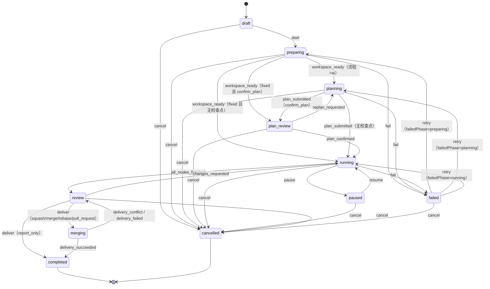
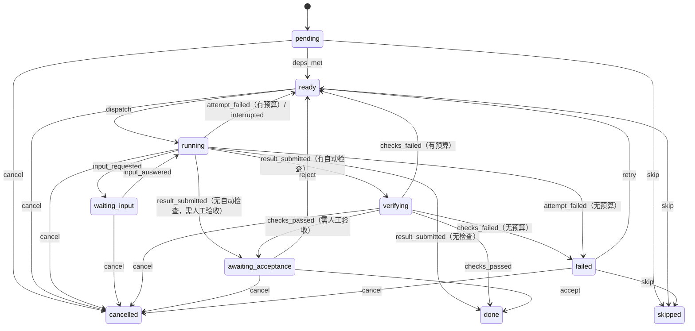
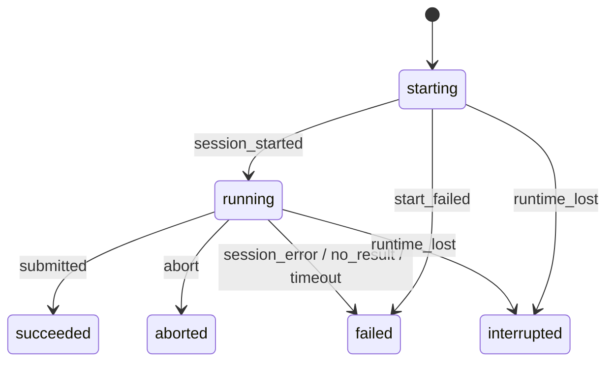

# 09 · 状态机

## 1. 机制

- 每个有生命周期的实体在 `packages/shared/src/fsm/<entity>.machine.ts` 定义一张转换表：

```ts
export const taskMachine = defineMachine<TaskStatus, TaskEvent>({
  draft:      { start: ['preparing'], cancel: ['cancelled'] },
  preparing:  { workspace_ready: ['planning', 'plan_review', 'running'], fail: ['failed'], cancel: ['cancelled'] },
  // ...
});
```

- `transition(machine, from, event, to?)`：查表；同一事件有多个可能目标时调用方必须给出 `to`，且必须在列表内；否则抛 `STATE_TRANSITION_INVALID`。**选哪个目标是 service 的业务判断，状态机只负责「是否允许」。**
- 状态字段只能在 repo 的 `updateStatus(id, from, to)` 中写，SQL 带 `WHERE status = :from`，影响 0 行即抛 `STATE_TRANSITION_INVALID`（防止并发下的脏写，不需要其他版本号机制）。
- 每次转换在同一事务内写一条 `task_events`（任务域）并在提交后经 event-bus 推送 SSE。
- 事件名为 `snake_case` 动词/过去分词，枚举 `TaskEvent`、`NodeEvent` 等与表同文件导出。
- 状态图由脚本 `pnpm gen:fsm-docs` 从转换表生成 Mermaid，校验本文是否同步（CI 检查）。

## 2. 任务 Task



| 状态 | 含义 | 进入时后端做什么 |
| --- | --- | --- |
| `draft` | 已创建未启动（仅专业模式「保存草稿」） | — |
| `preparing` | 建分支与 worktree | worktree 状态机 `creating → ready`；成功发 `workspace_ready` |
| `planning` | AI 规划中 | 创建 `plan` 类尝试；`submit_plan` 成功即发 `plan_submitted` |
| `plan_review` | 等用户确认计划 | 创建 `plan` 类 inbox 条目（点开跳到任务页的计划画布确认） |
| `running` | 执行节点 | 计划确认 → 生成节点（无依赖节点为 `ready`）→ 触发调度 |
| `paused` | 暂停：不再派发新节点，进行中的尝试继续跑完 | 专业模式可编辑未开始的节点 |
| `review` | 全部节点结束，等用户决定 | 生成结果摘要；创建 `delivery` 类 inbox 条目 |
| `merging` | 合并 / 推送 / 建 PR 中 | 见 delivery 状态机 |
| `completed` | 终态 | 清理 worktree；按设置删除本地分支（PR 交付保留分支） |
| `failed` | 某阶段失败且重试预算耗尽；`failedPhase` 记录阶段 | 创建 `failure` 类 inbox 条目 |
| `cancelled` | 终态 | 中止活动尝试；节点 → `cancelled`；关闭相关 inbox 条目（`dismissed`）；删除 worktree；分支默认删除（专业模式可选保留） |

**由节点推导的任务事件**（调度器在每次节点状态变化后判断）：

- `all_nodes_finished`：所有节点 ∈ {`done`, `skipped`}。
- `fail`（running 阶段）：存在 `failed` 节点 且 没有 `running/verifying/waiting_input` 的节点。一旦存在 `failed` 节点，调度器不再派发新节点。
- `changes_requested`：用户「让 AI 再改改」或「交给 AI 解决冲突」→ 新建计划版本，追加一个 `revise` 节点（依赖所有叶子节点），确认后回到 `running`。

## 3. 节点 Node



| 规则 | 说明 |
| --- | --- |
| 预算 | 每个节点最多 `node.maxAttempts` 次 `execute` 尝试；`checks_failed` 与 `attempt_failed` 都消耗预算；`reject`（人工驳回）与 `retry`（用户手动重试）不受预算限制，`retry` 会重置计数 |
| 重试携带反馈 | 回到 `ready` 时记录 `retryFeedback`（检查失败输出 / 评审问题 / 驳回意见 / 失败原因），下次尝试的提示词附带 |
| `waiting_input` | 两种来源：会话空闲且有未回答的阻塞问题；opencode 权限请求待处理 |
| 人工验收 | 节点 `acceptance.manual=true` 或任务开启 `accept_each_node` 时进入 `awaiting_acceptance`，并创建 `acceptance` 类 inbox 条目 |
| 跳过 | 仅专业模式；被跳过节点视为完成，下游可继续 |
| 重启恢复 | `running`/`verifying` 的节点：其尝试标 `interrupted`，节点回 `ready`（不消耗预算）；`waiting_input` 保持不变（opencode 会话持久化，回答后继续） |

**`result_submitted` 的目标选择**：有 `acceptance.checks` → `verifying`；否则需要人工验收 → `awaiting_acceptance`；否则 → `done`。

**`verifying`** 依次执行检查：`command` 在 worktree 中运行（超时 `ACCEPTANCE_COMMAND_TIMEOUT_MS`）；`ai_review` 创建 `review` 类尝试，`submit_review` 返回 `pass/fail`。任一失败即 `checks_failed`。

**提交代码**：节点到达 `done` 时，后端在 worktree 执行 `git add -A && git commit -m "<taskKey> <nodeTitle>"`（无改动则跳过），提交 sha 记录在节点上。模型不需要自己提交。

## 4. 尝试 Attempt



- `submitted`：`plan` 类为 `submit_plan` 校验通过；`execute` 类为 `submit_result`；`review` 类为 `submit_review`。尝试成功只表示「模型交付了结果」，验收结论在节点层。
- `no_result`：见 [03-architecture §2.4](03-architecture.md#24-会话空闲但未提交结果)。
- `timeout`：从 `running` 起超过 `attempt.timeoutMinutes`。
- `abort`：用户中止或任务取消；后端调用 opencode `session/{id}/abort`。
- `runtime_lost`：opencode 进程退出或应用重启时仍在进行。
- 终态：`succeeded` `failed` `aborted` `interrupted`。尝试不会被「恢复」，重试总是新建尝试（`plan` 类尝试可复用原会话继续，见 12-mcp-tools §4.3）。

## 5. 计划 Plan

| from | 事件 | to | 说明 |
| --- | --- | --- | --- |
| `draft` | `confirm` | `confirmed` | 同任务原 `confirmed` 版本同时 → `superseded` |
| `draft` | `supersede` | `superseded` | 产生了更新的草稿（重新规划 / 再次编辑） |
| `confirmed` | `supersede` | `superseded` | 暂停调整或「再改改」产生的新版本被确认 |

每个任务同一时刻至多一个 `draft`、一个 `confirmed`。版本号 `version` 在任务内自增。

## 6. Worktree

| from | 事件 | to |
| --- | --- | --- |
| `creating` | `created` | `ready` |
| `creating` | `create_failed` | `error` |
| `ready` | `remove` | `removing` |
| `removing` | `removed` | `removed` |
| `removing` | `remove_failed` | `error` |
| `error` | `remove` | `removing` |

## 7. 交付 Delivery

每次「合并 / 建 PR」创建一条 delivery 记录，初始 `running`。

| from | 事件 | to | 任务事件 |
| --- | --- | --- | --- |
| `running` | `succeeded` | `succeeded` | `delivery_succeeded` |
| `running` | `conflicted` | `conflict` | `delivery_conflict`（`details.files`） |
| `running` | `failed` | `failed` | `delivery_failed` |

本地合并流程（`squash` 为例）：在**主仓库**（不是 worktree）检查目标分支是否检出且干净 → 若用户主工作区当前分支即目标分支且有未提交改动，则失败并提示（不碰用户改动）→ `git merge --squash` → 提交 → 删除 worktree / 分支。冲突时 `git merge --abort` 恢复原状再报告冲突文件。

## 8. 需要你处理 Inbox

| from | 事件 | to |
| --- | --- | --- |
| `open` | `resolve` | `resolved`（用户作答 / 决定） |
| `open` | `dismiss` | `dismissed`（用户忽略，或关联任务/节点进入终态时自动） |

## 9. opencode 运行时 Runtime

| from | 事件 | to | 说明 |
| --- | --- | --- | --- |
| （检测） | `detected` | `stopped` / `not_installed` / `version_mismatch` | 启动与「重新检测」时执行 |
| `stopped` | `start` | `starting` | |
| `starting` | `listening` | `ready` | 从 stdout 解析到地址并且 `/config` 请求成功 |
| `starting` | `exited` | `crashed` | |
| `ready` | `exited` | `crashed` | 活动尝试全部 → `interrupted`；自动 `start` 一次 |
| `crashed` | `start` | `starting` | 自动一次，之后需用户在运行环境页点重启 |
| `ready` | `restart` | `starting` | 用户手动；先中止活动尝试 |
| `not_installed` / `version_mismatch` | `recheck` | （重新检测） | |
