# 09 · 状态机

## 1. 机制

- 每个有生命周期的实体在 `packages/shared/src/fsm/<entity>.machine.ts` 定义一张转换表：

```ts
export const taskMachine = defineMachine<TaskStatus, TaskEvent>({
  entity: 'task',
  states: TASK_STATUSES,
  events: Object.values(TaskEvent),
  initial: [TaskStatus.Draft],
  table: {
    [TaskStatus.Draft]: { [TaskEvent.Start]: [TaskStatus.Preparing], [TaskEvent.Cancel]: [TaskStatus.Cancelled] },
    // ...
    [TaskStatus.Completed]: { [TaskEvent.ReviewFeedback]: [TaskStatus.Running] },
  },
  reopenedBy: [TaskEvent.ReviewFeedback],
});
```

- 除 `reopenedBy` 声明的事件外没有事件的状态即终态（`isTerminalState`）：`reopenedBy` 是「工作已结束、只有这个明确的例外能重新开始」的事件，状态仍算终态（如以 PR 交付的已完成任务按审查意见修改，21 §7；已删除的 worktree 随之重建）。活动任务、批次「已结束」、是否显示「取消」等判断都按终态，不受它影响。

- `transition(machine, from, event, to?)`：查表；同一事件有多个可能目标时调用方必须给出 `to`，且必须在列表内；否则抛 `STATE_TRANSITION_INVALID`。**选哪个目标是 service 的业务判断，状态机只负责「是否允许」。**
- 状态字段只能在 repo 的 `updateStatus(id, from, to)` 中写，SQL 带 `WHERE status = :from`，影响 0 行即抛 `STATE_TRANSITION_INVALID`（防止并发下的脏写，不需要其他版本号机制）。
- 每次转换在同一事务内写一条 `task_events`（任务域）并在提交后经 event-bus 推送 SSE。
- 事件名为 `snake_case` 动词/过去分词，枚举 `TaskEvent`、`NodeEvent` 等与表同文件导出。
- 本文的状态图由 `pnpm gen:fsm-docs` 从转换表生成（`<!-- fsm:<name> -->` 标记之间的内容，勿手改）；`pnpm check` 执行 `gen:fsm-docs --check`，不同步即失败。图中只标事件名，多目标事件的目标选择写在各节表格中。

## 2. 任务 Task

<!-- fsm:task 由 pnpm gen:fsm-docs 生成，勿手改 -->
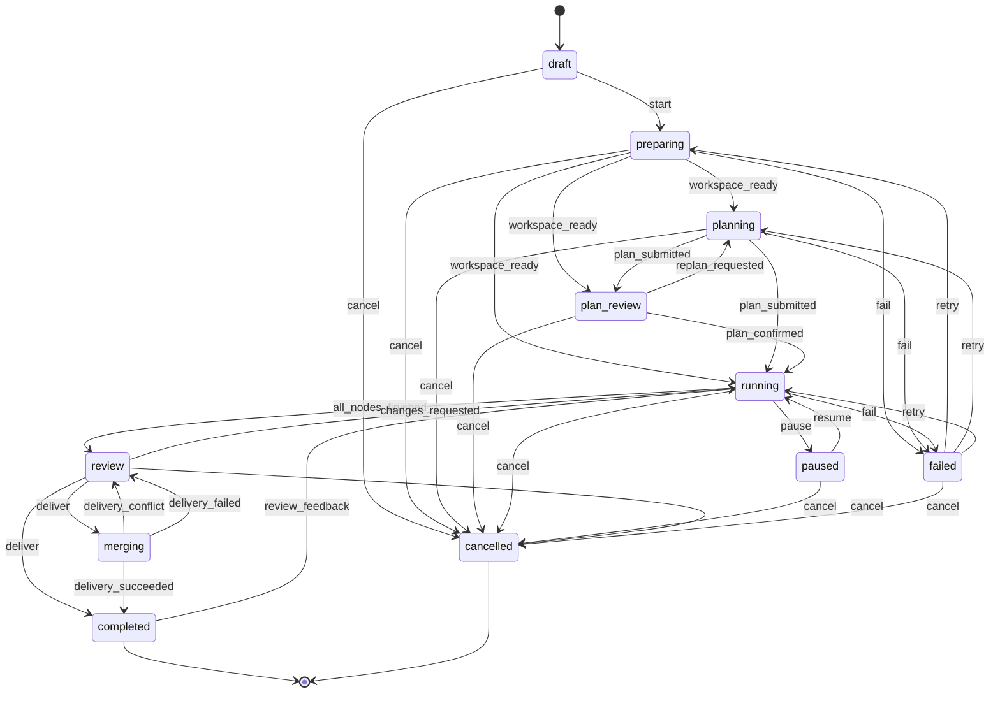
<!-- /fsm:task -->

多目标事件的目标选择（service 判断，状态机只校验是否允许）：

| 事件 | 目标 |
| --- | --- |
| `workspace_ready` | 流程 `planning=ai` → `planning`；fixed 且开启 `confirm_plan` → `plan_review`；fixed 且无检查点 → `running` |
| `plan_submitted` | 开启 `confirm_plan` → `plan_review`；否则 → `running` |
| `deliver` | `squash` / `merge` / `rebase` / `pull_request` → `merging`；`report_only` → `completed` |
| `delivery_conflict` / `delivery_failed` | → `review` |
| `retry` | 按 `failedPhase` 回到 `preparing` / `planning` / `running` |
| `review_feedback` | → `running`；只限最近一次成功的交付为 `pull_request` 且该 PR 仍打开（21 §3） |

| 状态 | 含义 | 进入时后端做什么 |
| --- | --- | --- |
| `draft` | 已创建未启动（仅专业模式「保存草稿」） | — |
| `preparing` | 建分支与 worktree | worktree 状态机 `creating → ready`；成功发 `workspace_ready` |
| `planning` | AI 规划中 | 创建 `plan` 类尝试；`submit_plan` 成功即发 `plan_submitted` |
| `plan_review` | 等用户确认计划 | 创建 `plan` 类 inbox 条目（点开跳到任务页的计划画布确认） |
| `running` | 执行节点 | 计划确认 → 生成节点（无依赖节点为 `ready`）→ 触发调度 |
| `paused` | 暂停：不再派发新节点，进行中的尝试继续跑完（依赖满足的节点仍会 `pending → ready`） | 专业模式可调整计划：只能改动、删除未开始（`pending` / `ready`，`EDITABLE_NODE_STATUSES`）的节点，可新增节点；保存为草稿版本，确认后重新物化（见下），任务保持暂停；`resume` 时未确认的草稿被取代 |
| `review` | 全部节点结束，等用户决定 | 生成结果摘要；创建 `delivery` 类 inbox 条目 |
| `merging` | 合并 / 推送 / 建 PR 中 | 见 delivery 状态机 |
| `completed` | 终态（唯一例外：以 PR 交付、PR 仍打开的任务可经 `review_feedback` 按审查意见回到 `running`，21 §7） | 清理 worktree；按设置删除本地分支（PR 交付保留分支） |
| `failed` | 某阶段失败且重试预算耗尽；`failedPhase` 记录阶段 | 创建 `failure` 类 inbox 条目 |
| `cancelled` | 终态 | 中止活动尝试；节点 → `cancelled`；关闭相关 inbox 条目（`dismissed`）；删除 worktree；分支默认删除（专业模式可选保留） |

**由节点推导的任务事件**（调度器在每次节点状态变化后判断）：

- `all_nodes_finished`：所有节点 ∈ {`done`, `skipped`}。
- `fail`（running 阶段）：存在 `failed` 节点 且 没有 `running/verifying/waiting_input` 的节点。一旦存在 `failed` 节点，调度器不再派发新节点。失败码：节点的检查命令无法运行 → `CHECK_COMMAND_UNRUNNABLE`，否则 `NODE_ATTEMPTS_EXHAUSTED`（08）。
- `changes_requested`：用户「让 AI 再改改」或「交给 AI 解决冲突」→ 新建计划版本，追加一个 `revise` 节点（依赖所有叶子节点），确认后回到 `running`。
- `review_feedback`（21）：已完成的 PR 任务「让 AI 按意见再改改」→ 抓取并快进任务分支、重建 worktree（worktree `restore`）→ 同上追加 `review_fix_<n>` 节点，`completed → running`，`finishedAt` 清空。

**暂停调整的重新物化**（`nodes.rematerialize`，M5-02）：确认暂停中的草稿时，先再次检查已开始的节点没有被改动或删除（期间可能有节点结束，`NODE_NOT_EDITABLE`）；未开始的节点按新定义改写（`plan_id`、标题、角色、指令、依赖、验收、顺序），新节点按 key 创建（初始 `pending` / `ready` 同物化），被删除的未开始节点删除；已开始的节点只更新顺序。改写后依赖未全部完成的 `ready` 节点经 `deps_unmet` 回到 `pending`，由调度器重新放行。

## 3. 节点 Node

<!-- fsm:node 由 pnpm gen:fsm-docs 生成，勿手改 -->
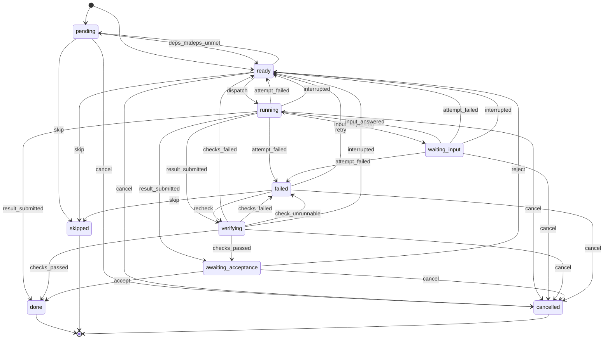
<!-- /fsm:node -->

节点创建时：无依赖 → `ready`，否则 `pending`。

| 规则 | 说明 |
| --- | --- |
| 预算 | 每个节点最多 `node.maxAttempts` 次 `execute` 尝试；`checks_failed` 与 `attempt_failed` 都消耗预算；`reject`（人工驳回）与 `retry`（用户手动重试）不受预算限制，`retry` 会重置计数；`check_unrunnable` 不消耗（这次尝试退回） |
| 检查命令无法运行（D116） | 命令检查退出 127 / 126，且输出里 shell 自己的报错行（`<shell>: [line N: \| N: ]<程序>: command not found \| not found \| No such file or directory`，126 为 `Permission denied`）点名的程序是检查命令自己直接运行的（按 `&&` `\|\|` `;` `\|` 分出的每段的第一个词，跳过前置 `NAME=value`）：`verifying → failed`（`check_unrunnable`），不发回 AI（`retryFeedback` 不变）、不消耗预算、后面的检查不再跑；任务照常 `fail`，失败码 `CHECK_COMMAND_UNRUNNABLE`。其他情况（检查命令里的脚本缺依赖、工具自己的报错）仍是 `checks_failed` |
| 页面体检无法运行（29 §7.4） | 任务的预览在这个 worktree 里自应用启动以来从没就绪过（安装命令失败、启动超时、进程退出），或项目的预览配置已删除：同样是 `check_unrunnable`，失败码 `BROWSER_CHECK_UNRUNNABLE`。预览就绪过、这次却起不来，是这次改动的问题：`checks_failed`，预览日志末尾作为反馈 |
| 检查顺序 | 命令检查 → 页面体检 → AI 评审（`CHECK_KIND_ORDER`），与验收里的书写顺序无关；一项不通过，后面的不再跑 |
| 重新检查 | `recheck`（`failed → verifying`）：用这一步已提交的结果重新跑验收，不新建尝试，计数记为 1。任务 `retry` 时，检查无法运行（命令或页面体检）的失败步骤走 `recheck`；「修改检查命令」后，最近一次执行尝试已提交结果、未通过命令检查的失败步骤走 `recheck`（11 §5） |
| 跳过检查 | 「跳过这项检查」给未完成步骤中这条命令检查（页面体检则是所有页面体检，它们共用任务的预览）标 `skipped`：验收时不运行，记一条 `skipped: true, passed: true` 的结果（不挡住步骤），其余检查照常；结果卡与 PR 说明写明未验证 |
| 重试携带反馈 | 回到 `ready` 时记录 `retryFeedback`（检查失败输出 / 评审问题 / 驳回意见 / 失败原因），下次尝试的提示词附带 |
| `waiting_input` | 两种来源：会话空闲且有未回答的阻塞问题；opencode 权限请求待处理。等待期间尝试仍是 `running`（不计超时），因此仍可能失败（用户中止 → `attempt_failed`）或中断（运行时消失时待处理的权限请求随之失效 → `interrupted`） |
| 人工验收 | 节点 `acceptance.manual=true` 或任务开启 `accept_each_node` 时进入 `awaiting_acceptance`，并创建 `acceptance` 类 inbox 条目 |
| 跳过 | 仅专业模式（`pending` / `ready` / `failed` → `skipped`）；被跳过节点视为完成，下游可继续。任务因该节点失败时，跳过后「重试任务」即继续 |
| 依赖变化 | `deps_unmet`：暂停调整使 `ready` 节点多了未完成的依赖 → `pending` |
| 重启恢复 | `running`/`verifying` 的节点：其尝试标 `interrupted`，节点回 `ready`（不消耗预算）；等待阻塞问题答案的 `waiting_input` 保持不变（opencode 会话持久化，回答后在同一会话继续）；等待权限的 `waiting_input` 回 `ready`（权限请求随 opencode 进程失效，条目 dismiss） |

**`result_submitted` 的目标选择**：有 `acceptance.checks` → `verifying`；否则需要人工验收 → `awaiting_acceptance`；否则 → `done`。`checks_passed` 同理（需人工验收 → `awaiting_acceptance`，否则 `done`）；`checks_failed` / `attempt_failed` 有预算 → `ready`，无预算 → `failed`；`check_unrunnable` → `failed`；`recheck` → `verifying`；`interrupted`（重启恢复）→ `ready`。

**`verifying`** 依次执行检查：`command` 在 worktree 中运行（超时 `ACCEPTANCE_COMMAND_TIMEOUT_MS`）；`ai_review` 创建 `review` 类尝试，`submit_review` 返回 `pass/fail`。任一失败即 `checks_failed`。

**提交代码**：节点到达 `done` 之前，后端在 worktree 执行 `git add -A && git commit -m "<taskKey> <nodeTitle>"`（无改动则跳过，`commit_sha` 为空），提交 sha 记录在节点上；先提交再转换，下游节点不会在提交之前开始。提交者为 `GIT_COMMIT_IDENTITY`，带 `--no-verify` 且关闭签名（D48）。并行节点共享任务工作区，先完成的节点的提交会包含此刻工作区中的全部改动。模型不需要自己提交。

**AI 评审未完成**：评审会话没有提交结论就结束（未提交、出错、超时、被中止）按 `checks_failed` 处理；运行时消失则 `interrupted`（D49）。

## 4. 尝试 Attempt

<!-- fsm:attempt 由 pnpm gen:fsm-docs 生成，勿手改 -->
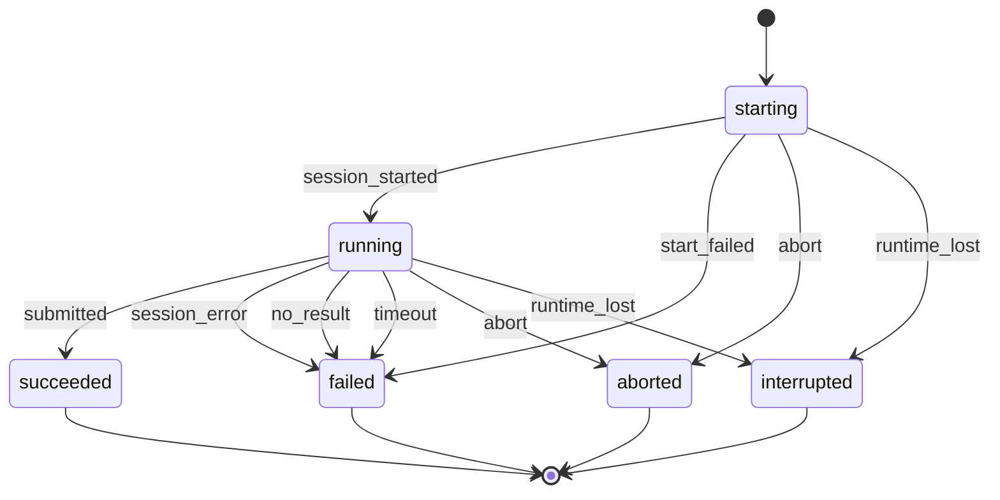
<!-- /fsm:attempt -->

- `submitted`：`plan` 类为 `submit_plan` 校验通过；`execute` 类为 `submit_result`；`review` 类为 `submit_review`；`research` 类为 `submit_answer`；`deck_outline` 类为 `submit_outline`；`deck_slides` 类为这次工作的最后一个目标页的 `submit_slide`（23 §4.1）。知识问答的轮次与 PPT 没有自己的状态机，它们的状态是尝试状态的投影（18 §3、23 §4.3）。尝试成功只表示「模型交付了结果」，验收结论在节点层。
- `no_result`：见 [03-architecture §2.4](03-architecture.md#24-会话空闲但未提交结果)。
- `timeout`：从 `running` 起超过 `attempt.timeoutMinutes`。
- `abort`：用户中止或任务取消；后端调用 opencode `session/{id}/abort`。会话仍在创建中（`starting`）时也可中止（任务取消），之后不再发送首条消息。
- `runtime_lost`：opencode 进程退出、用户重启 opencode、应用退出（后端先中断再结束 opencode，§9），或后端启动时发现上次仍在进行（会话已不存在）。会话还在创建时运行时消失，创建请求随之失败，这次失败属于中断本身，不再记为 `start_failed`。
- 终态：`succeeded` `failed` `aborted` `interrupted`。尝试不会被「恢复」，重试总是新建尝试（`plan` 类尝试可复用原会话继续，见 12-mcp-tools §4.3）。

## 5. 计划 Plan

<!-- fsm:plan 由 pnpm gen:fsm-docs 生成，勿手改 -->
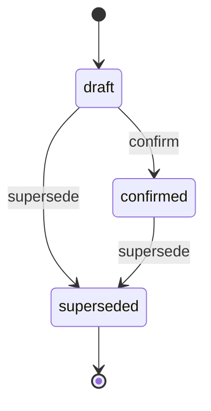
<!-- /fsm:plan -->

- `confirm`：同任务原 `confirmed` 版本同时 `supersede` → `superseded`。
- `draft` 的 `supersede`：产生了更新的草稿（重新规划 / 再次编辑）。
- `confirmed` 的 `supersede`：暂停调整或「再改改」产生的新版本被确认。

每个任务同一时刻至多一个 `draft`、一个 `confirmed`。版本号 `version` 在任务内自增。

## 6. Worktree

<!-- fsm:worktree 由 pnpm gen:fsm-docs 生成，勿手改 -->
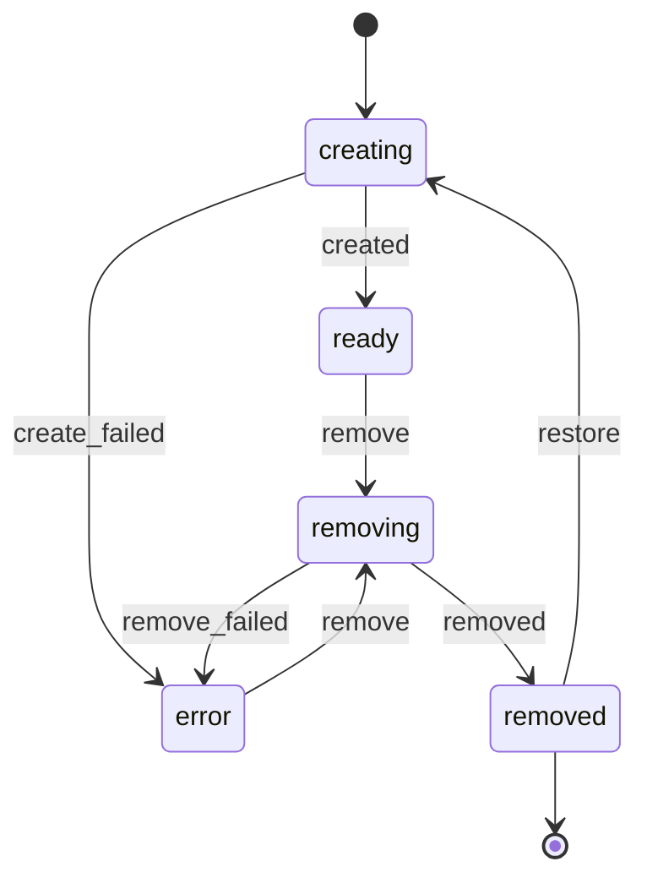
<!-- /fsm:worktree -->

`restore`（21 §4.2）：以 PR 交付、worktree 已删除的任务按审查意见修改时，同一条记录回到 `creating`（`removed_at` 清空），在原路径上 `git worktree add <path> <branch>`（已有分支），成功 `created → ready`，失败 `create_failed → error`。

## 7. 交付 Delivery

每次「合并 / 建 PR」创建一条 delivery 记录，初始 `running`。

<!-- fsm:delivery 由 pnpm gen:fsm-docs 生成，勿手改 -->
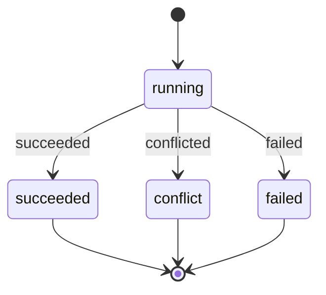
<!-- /fsm:delivery -->

同一事务内对应的任务事件：`succeeded` → `delivery_succeeded`；`conflicted` → `delivery_conflict`（`details.files`）；`failed` → `delivery_failed`。

本地合并流程（`delivery.merge.ts`，D52）：

1. 检查（任一不满足即返回错误，不建 delivery、不改状态）：目标分支存在（`DELIVERY_TARGET_NOT_FOUND`）；任务 worktree 没有未提交改动（`WORKTREE_DIRTY`）；目标分支检出所在的工作区（通常是用户的主工作区）干净，否则 `DELIVERY_TARGET_DIRTY`（不碰用户改动）。合并本身在仓库锁内进行，锁内、合并前再查一次这个工作区是否干净：检查与合并之间有人暂存了文件时同样 `DELIVERY_TARGET_DIRTY`（交付记为失败，任务回到待合并），压缩合并的提交因此不会带上用户暂存的文件。应用外的 git 进程不受这把锁约束。
2. 建 delivery（`running`），任务 `deliver → merging`。
3. 在仓库锁内、在**主仓库**中合并：目标分支检出在哪个工作区就在哪里合并（用户主工作区在目标分支上时其文件随之更新）；没有检出时在临时 worktree 中合并后删除。提交者为 `GIT_COMMIT_IDENTITY`、`--no-verify`、关闭签名（同 D48）。
   - `squash`：`git merge --squash` → 提交「<任务标题> (<任务编号>)」；目标分支已含全部改动时不提交。冲突时 `git reset --merge`（squash 没有 MERGE_HEAD，`merge --abort` 不可用）。
   - `merge`：`git merge --no-ff -m …`；冲突时 `git merge --abort`。
   - `rebase`：在任务 worktree 中 `git rebase <target>`（任务分支已包含目标分支时跳过，例如解决冲突时已合入），再在目标处 `git merge --ff-only`；冲突时 `git rebase --abort`。
4. 成功 → `succeeded`（`commit_sha` 为目标分支新提交）+ 任务 `completed`，交付条目 resolved；之后删除 worktree，按 `delivery.deleteBranchAfterMerge` 删除分支（删除失败只记在 worktree 上）。冲突 → 恢复原状，`conflicted`（`conflict_files`）+ 任务回 `review`。其他 git 失败 → `failed` + 任务回 `review`。
5. 重启时仍为 `running` 的 delivery 记为 `failed`（`DELIVERY_INTERRUPTED`），任务回 `review`。

PR 交付（`pull_request`）：推送任务分支（普通推送，不 force）后按分支查找打开的 PR/MR，找到就沿用它（按审查意见修改后推送回同一个 PR，21 §5），没有才新建；成功同上 `succeeded`（`pr_url`）+ 任务 `completed`，worktree 删除、分支保留。

## 8. 需要你处理 Inbox

<!-- fsm:inbox 由 pnpm gen:fsm-docs 生成，勿手改 -->
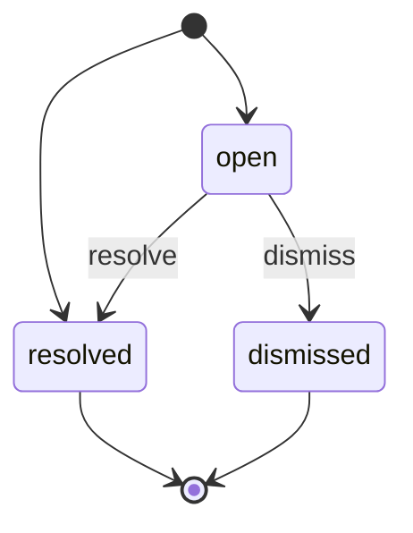
<!-- /fsm:inbox -->

- `resolve`：用户作答 / 决定。
- `dismiss`：用户忽略，或关联任务/节点进入终态时自动。
- 模型按自己的假设继续的提问（未问用户）直接以 `resolved` 创建，作为记录。

## 9. opencode 运行时 Runtime

<!-- fsm:runtime 由 pnpm gen:fsm-docs 生成，勿手改 -->
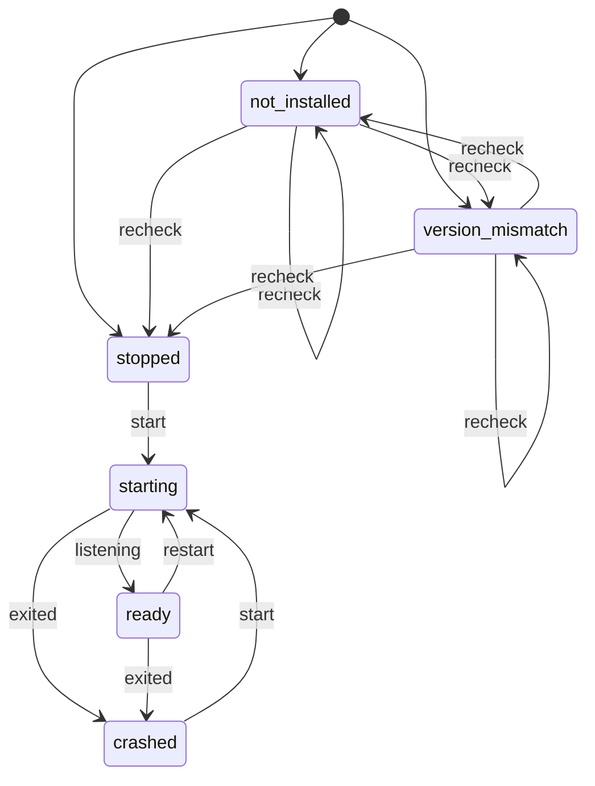
<!-- /fsm:runtime -->

- 初始状态由环境检测（启动时与「重新检测」`recheck`）决定：`stopped` / `not_installed` / `version_mismatch`。
- `listening`：从 stdout 解析到地址并且 `/config` 请求成功。
- `starting` 的 `exited`：进程退出，或 `OPENCODE_START_TIMEOUT_MS` 内未报告地址 / `/config` 失败（此时后端结束进程）。
- `ready` 的 `exited`：活动尝试全部 → `interrupted`（`runtime_lost`）。
- 进入 `crashed` 后自动 `start` 一次；自动机会用完后需用户在运行环境页点重启（`crashed` 的 `start`），用户的手动启动 / 重启会重新给一次自动机会。
- `restart`：用户手动；活动尝试先 → `interrupted`（会话随旧进程一起消失，可重试），再结束旧进程启动新进程。
- 后端退出（应用退出）时：与 `restart` 一样，活动尝试先 → `interrupted`（`runtime_lost`；等待阻塞问题答案的除外，D46），再结束 opencode 进程树，运行时本身不做状态转换。顺序不能反：结束进程时正在进行的请求（如创建会话）会失败，若尝试仍在进行就会被记成 `failed` 并消耗预算（D73）。「重新检测」除了 `not_installed` / `version_mismatch` 的 `recheck`，还会 `start` 一个 `crashed` 的运行时（Windows 上补装 Git Bash 之后，D72）。

## 10. 助手确认 AssistantConfirmation（v1.1）

<!-- fsm:assistantConfirmation 由 pnpm gen:fsm-docs 生成，勿手改 -->
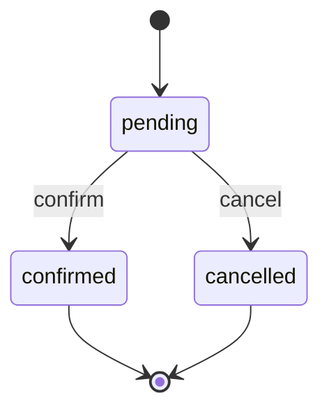
<!-- /fsm:assistantConfirmation -->

- 助手调用 write（不在「总是允许」中）或 critical 级操作时以 `pending` 创建（15 §4），工具返回 `needs_confirmation`。
- `confirm`：用户在确认卡片上确认；后端随后执行操作，结果（输出或错误码）写入 `result`，并作为下一条消息发回同一会话。操作本身失败也是 `confirmed`（用户确认过，结果是错误）。
- `cancel`：用户取消；会话收到「用户取消了该操作」。
- 没有超时，重启后仍为 `pending` 的确认照常可确认或取消。

## 11. 定时任务 Schedule（v1.2）

<!-- fsm:schedule 由 pnpm gen:fsm-docs 生成，勿手改 -->
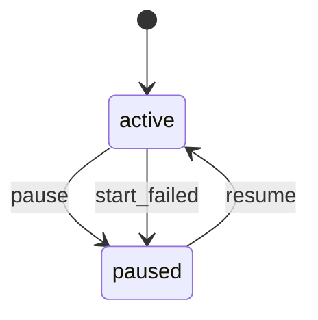
<!-- /fsm:schedule -->

- 创建即 `active`（[22 §3](22-scheduled-tasks.md#3-状态机09-11)）；没有终态，删除定时任务即删除记录（运行记录随之删除，开出的任务保留）。
- `pause`：用户暂停，`next_run_at` 清空。
- `resume`：用户恢复，从现在起计算 `next_run_at`（暂停期间错过的不补），并把该定时任务未关闭的 `schedule_failure` 条目记为 `resolved`。
- `start_failed`：到点时开不了任务（`checkCreate` 等抛出 `AppError`）；同一事务内记一条 `failed` 运行、创建 `schedule_failure` 条目（D91）。「立即运行一次」失败不触发它，错误直接返回给用户。
- 到点运行本身不改变状态：每次到点在 `schedule_runs` 记一条 `started` / `skipped` / `failed`，并推进 `next_run_at`（22 §4）。

## 12. 页面预览 Preview（v1.3）

<!-- fsm:preview 由 pnpm gen:fsm-docs 生成，勿手改 -->
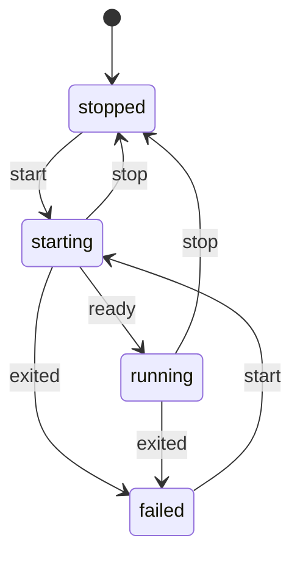
<!-- /fsm:preview -->

- 每个任务 worktree 最多一个预览，只存在内存里（[29 §4.2](29-browser.md#42-一个预览的生命周期)）；应用重启后都是 `stopped`。
- `start`：第一次需要时（AI 的浏览器工具、页面体检、用户「打开预览」、助手）。这个 worktree 第一次启动前先运行项目的安装命令。
- `ready`：就绪路径（`readyPath`）得到任何 HTTP 响应。
- `exited`：进程退出，或 `PREVIEW_START_TIMEOUT_MS` 内没有就绪（此时后端结束进程树）；保留日志末尾 `PREVIEW_LOG_TAIL_CHARS` 字符。
- `stop`：用户停止、空闲 `preview.idleMinutes`、达到 `preview.maxRunning` 时被淘汰、任务进入终态或 worktree 删除；后端结束进程树。`failed` 的预览没有进程，任务结束时直接从内存中移除，不需要 `stop`。

## 13. 待实施：附件与需求清单（30 / 31）

设计登记，源码尚未实现。

- 附件没有状态机：校验通过才写入记录，记录存在即可用（30 §3.1）。删除只有「无引用且超过保留时间」的清理，见 10 §6。
- `TaskStatus` 与转换不变。清单编辑只在 `draft`、`plan_review`、`review`；`tasks.reverifyRequirements` 与人工结论只在 `review`。重新核验沿用 `appendRevision` 的 `changes_requested` → `running`，只是追加的是核验节点。
- `NodeStatus` 与转换不变。`NodeKind.Verify` 的节点在 `verifying` 时运行全部检查（不在第一个失败处停止），失败也走 `checks_passed` 到 `done`（结果记为该项未通过；命令无法运行记为未核验），不进入失败重试，也不因 `CHECK_COMMAND_UNRUNNABLE` 让任务失败；它的执行尝试失败仍按既有规则重试。（Q-02 已实现：`nodes.run.ts` 的 `finishVerifyStep`，完成时在同一事务里通知 `tasks` 写结论）
- `RequirementDisplayStatus` 是纯函数的计算值（31 §3），没有 setStatus 操作。

## 14. 助手单轮

每次发送前创建 `running` 轮次；模型空闲、用户停止、错误、运行时消失、后端重启、时限分别结束，结束后不能重新开始。未知用量保持空值，不影响实际结束状态；没有收到终止事件的旧轮次在启动时标为 `interrupted / backend_restart`，不自动重试。

<!-- fsm:assistantTurn 由 pnpm gen:fsm-docs 生成，勿手改 -->
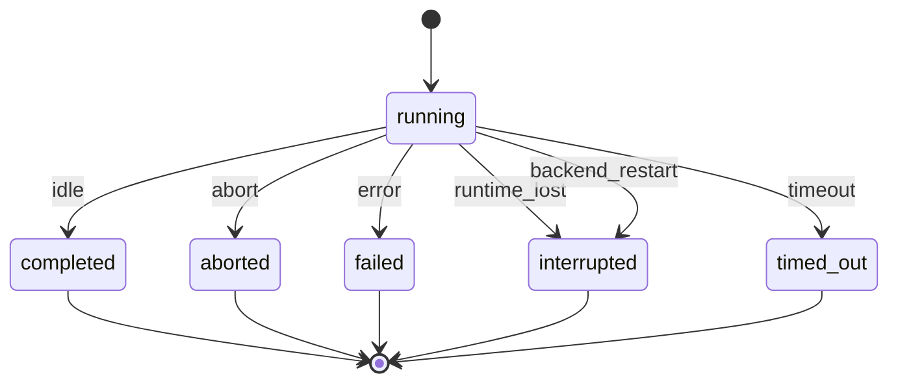
<!-- /fsm:assistantTurn -->

## 15. 成员分析 TeamAnalysis（v1.3，33 §6.4）

一个项目同时只运行一个分析，其余排队（不计入调度器并发，同 D68）；排队的首条消息只在内存里。

<!-- fsm:teamAnalysis 由 pnpm gen:fsm-docs 生成，勿手改 -->
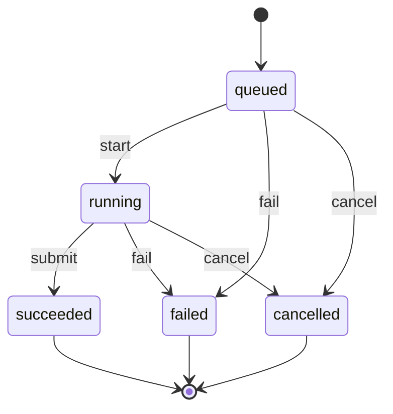
<!-- /fsm:teamAnalysis -->

- `start`：轮到它时开始只读会话（`AttemptKind.TeamAnalysis`）。会话没能开始 → `fail`（记下错误），接着开始下一个。
- `submit`：`submit_member_analysis` 校验通过，报告随之写入。
- `fail`：会话结束却没有提交（出错、超时、运行时消失）；应用重启时，排队与运行中的分析一律 `fail`（`TEAM_ANALYSIS_INTERRUPTED`），可「重新生成」。
- `cancel`：排队中直接取消；运行中先记为取消，再中止会话，会话结束不再改变它。
