# 25 · 会话流重设计（v1.2 体验修正）

> 状态：D102–D104 **用户已确认（2026-10-22）并已实现**。设计阶段的静态原型与截图在 [`25-conversation-stream/`](25-conversation-stream/)；实现后的界面见 J9 走查截图（`screenshots/walkthrough/`）。

## 1. 要解决的问题

用户试用安装包后的反馈（原话）：

1. 「任务详细尝试界面、还有节点详情的过程界面需要优化，我们做一个固定大小的会话框吧，然后在里面进行流式刷新，并且增加特效。知识库的会话流也是一样的问题。」
2. 「任务详细尝试界面的指令如果过长，会超出框外。」
3. 「节点执行完之后，这个步骤太长了要划到很下面才能看到其他的，应该默认收起来，给个箭头展开。」
4. 「整体项目的会话流都重新设计一下，现在的不太好看，模型的思考也显示不出来。」

现在一共有四套各写各的会话流显示：

| 位置 | 组件 | 问题 |
| --- | --- | --- |
| 任务页抽屉「过程」页签、简单模式的步骤页 | `attempts/process-view.tsx`（`processLines`） | 不限高，随内容把抽屉撑长；**丢掉思考**；「跟随最新」是一个勾选框，靠整页 `scrollIntoView` |
| 专业模式步骤页、运行环境页、PPT「AI 记录」、知识问答专业视图 | `attempts/transcript-view.tsx` | 不限高；每条都是一个 `<details>` 加灰色小字，像日志而不是对话；思考折叠成一行「思考」，看不出有内容 |
| 知识问答研究过程卡 | `knowledge/research-card.tsx` | 只显示四个阶段与读过的文件，看不到研究员在想什么、做了哪些查询 |
| 应用助手面板 | `assistant/message-list.tsx` | 已按 D84 重做，效果最好；但思考也是一行折叠，没有「上翻后停止跟随」 |

## 2. 根因

### 2.1「模型的思考显示不出来」

**opencode 1.19.0 发送思考，后端也存下了，是前端在简单视图里丢掉了它。**

- opencode 的 `message.part.updated` 带 `type: "reasoning"` 的片段，`message.part.delta` 流式追加；`opencode.events.ts` 把它解析为 `kind: 'reasoning'` 的 `Text` 事件，`attempts.session-view.ts` 写成会话流的 `reasoning` 条目（10 §3）。
- 用真实 opencode 与免费模型复现：用户本机安装包的数据目录里（opencode 1.19.0 托管，模型 `opencode/deepseek-v4.1-flash`，2026-10-22 的 10 次尝试），**每一次尝试都有 `reasoning` 条目**，而且思考是主体：

  | 尝试 | 类型 | 思考片段 | 正文片段 | 工具调用 |
  | --- | --- | --- | --- | --- |
  | `175201d3` | 执行 | 11 | **0** | 17 |
  | `3ff2fc0a` | 执行 | 34 | 11 | 64 |
  | `0c7203f5` | 执行 | 47 | 2 | 63 |
  | `0422d6ab` | 研究 | 5 | 1 | 11 |

  `3ff2fc0a` 一次尝试的思考合计约 15.9 万字符，正文只有几句话。
- `process-lines.ts` 的 `processLines()` 按 14 §3.4 的旧规定「思考过程只在专业视图显示」跳过了 `reasoning`；于是像 `175201d3` 这样没有正文的尝试，简单视图里只剩一串工具调用行，看起来「模型什么都没说」。专业视图（`TranscriptView`）显示了思考，但折叠成一行灰色小字「思考」，与发给 AI 的消息、工具结果混在一起，不展开看不出有内容。
- 结论：不是 opencode 或存储的问题，不需要改 provider 配置；改显示规则（§5）与显示方式（§4）。

### 2.2「指令过长超出框外」

专业步骤页右栏「指令」是 `<pre class="instructions">`（`node-page.module.css`）：`white-space: pre-wrap` 但没有 `overflow-wrap`，而右栏是固定 320px 的网格列。指令里的长路径、URL、长英文标识符没有断点，就伸出面板。会话流里「发给 AI 的消息」用的 `.block` 有 `overflow-wrap: anywhere`，不受影响。修复：指令与会话流内所有文字都 `overflow-wrap: anywhere`，并且长内容默认收起（§4.4）。

### 2.3「步骤太长要划到很下面」

会话流不限高，一次几十上百个工具调用就是几十上百行，直接撑开抽屉或页面；结束后也照样全部展开。

### 2.4 流式「一顿一顿」、会话流文件很大（D104）

正文与思考每增长 `TRANSCRIPT_TEXT_FLUSH_CHARS`（200）个字符写一行，**每行是这个片段到当时为止的全文**（10 §3）。于是：

- 界面每 200 个字符才跳一次，看起来不是流式（知识问答的草稿为此单独改成 24 个字符，D67 ②）。
- 文件大小随片段长度平方增长：上面 `3ff2fc0a` 一次 9 分钟的尝试 5.0 MB，规划尝试 `9a2e1f2c` 8.8 MB，几乎全是重复的思考全文；SSE 也在反复推送同样的全文。

## 3. 一个共用的会话流组件（D102）

新建 `features/stream/`，取代 `ProcessView` 与 `TranscriptView`，所有显示尝试会话流的地方共用：

| 位置 | 用法 | 盒子高度 |
| --- | --- | --- |
| 任务页抽屉「过程」、简单模式步骤页 | 这个步骤最近一次执行尝试 | `max(320px, 100dvh − 240px)`（抽屉页签下方的高度） |
| 专业模式步骤页（尝试列表改为纵向排列，见下） | 每次尝试一个盒子 | `clamp(360px, 100vh − 340px, 640px)` |
| 知识问答研究过程卡 | 卡片的展开区域就是盒子；四个阶段移到盒子标题行 | 300px |
| 运行环境页（调试尝试）、PPT「AI 记录」 | 同专业步骤页 | 同上 |

- **应用助手面板**本身就是一个固定大小、贴底的框，保留自己的布局与卡片（确认、导航、附件，D84）；只换用共用的**思考块**（§4.2）与**贴底 / 回到最新**（§4.1），动作条继续用 `ToolRow`（它的标题来自操作清单，与尝试的工具不同）。
- **专业步骤页的尝试**：现在左边是尝试列表、右边是选中尝试的详情；改为在「过程」页签里按时间纵向排列每次尝试的盒子（标题行：类型与序号、结果、模型、tokens、用时、提醒次数），**已结束的默认收起，运行中的展开**；`?attempt=` 仍然有效（展开并滚到那一次）。原来的键值表（模型、提醒次数、用量、成本、时间、错误）并入标题行与展开后的第一行。
- 任务页规划阶段的一行进展（14 §3.3）不变：它只显示最新一句，不是会话流。

### 3.1 结构

```
features/stream/
├─ stream-items.ts        纯函数：会话流条目 → 显示条目（替代 process-lines.ts，单测）
├─ conversation-stream.tsx 盒子：标题行（状态、标题、当前进展、摘要、箭头）+ 滚动区 + 回到最新
├─ use-stick-to-bottom.ts  贴底跟随：靠近底部时跟随，上翻后停止，返回新条目数
├─ thinking-block.tsx      思考块（助手面板也用）
├─ action-bar.tsx          动作条 / 动作组
└─ stream.module.css
```

`streamItems(entries, { directory, mode, live })` 输出：

| 显示条目 | 来源 | 说明 |
| --- | --- | --- |
| `text` | `text` | Markdown 正文 |
| `thinking` | `reasoning` | 文字、用时（本条最后一行的 `ts` − 前一条的 `ts`）、是否正在写 |
| `action` | `tool_call` + 对应的 `tool_result` | 一行动作（沿用 `toolAction` / `toolActionLabel`），状态：运行中 / 完成 / 失败 / 已中断（尝试已结束仍无结果） |
| `group` | 结束后连续 ≥ 3 个 `action` | 摘要「查看 3 个文件 · 搜索 2 次 · 运行 1 条命令（1 条失败）」；含失败的组自动展开 |
| `prompt` | `user_message` | 只在专业模式 |
| `wait` | `permission` | 「等待你允许：…」+「去处理」（仍待处理时） |
| `notice` | `system` | 分隔线样式的一句话（已提醒、重试中、超时、已中止、运行时消失） |
| `error` | `error` | danger 底的一行，错误码文案 |

`report_progress` 在运行中显示在标题行（「当前进展」），流里只保留一行 `notice`「AI 汇报：…」，不再重复成动作行。

## 4. 交互与视觉

截图见 §8。视觉沿用 D84 的克制风格：细边框、大圆角、次要信息弱化；只用主题令牌与 `base.css` 的尺度变量，不写颜色字面量。

### 4.1 固定大小的盒子

- 盒子固定高度（§3 的表），内部滚动（`overscroll-behavior: contain`，不带动外层页面滚动）。
- **贴底跟随**：打开时滚到最新；新内容到达时，如果用户当前在底部 48px 以内就继续贴底。
- **上翻即停止跟随**：用户向上滚动离开底部后不再自动滚动；盒子底部居中浮出「↓ 回到最新 · N 条新内容」胶囊，点击平滑滚到底部并恢复跟随。取代现在的「跟随最新」勾选框。
- 标题行：状态图标（运行中旋转、完成 ✓、失败 ✕）、标题（简单模式「执行过程」/「研究过程」，专业模式「执行 #3」）、运行中的当前进展（运行色）、摘要（结束后：结果 · 思考 N 段 · N 个动作 · 用时），右侧箭头。

### 4.2 思考块

- 每段思考一个块，**默认收起**为一行：✦ 图标、「思考了 6 秒」、第一句的斜体预览（单行省略）、右侧箭头；点击展开为左侧竖线 + 弱化文字的全文。
- **正在思考**时（最后一条是仍在增长的思考）：块高亮（`accent-fill` 底、`accent-line` 边），标题「正在思考」带流光；只露出最后 5 行、顶部渐隐，文字末尾是打字光标，像在往上滚动。这段思考写完（下一条到来或尝试结束）后自动收起成一行。
- 思考按模型原文显示，不翻译（`deepseek-v4.1-flash` 的思考多为英文）。

### 4.3 动作条与动作组

- 一次工具调用一行（30px）：18px 状态图标（运行中脉冲圆点、完成 ✓、失败 ✕）、动词（「查看」「编辑」「运行」「搜索」「提交结果」…，现有 `toolActionLabel`）、对象（等宽弱化、单行省略，悬停显示全文）、编辑的 `+12 −3`、失败时右侧「退出码 1 / 失败」。运行中的动词流光。
- 简单模式：只有**失败的**动作可以展开，看错误输出；专业模式：全部可以展开，显示内部工具名、原始输入与输出（等宽、最高 180px 内部滚动）。
- **动作组**：已结束的会话流里，正文或思考之间连续 3 个及以上的动作折叠成一行摘要（图层图标 + 「查看 3 个文件 · 搜索 2 次」+ 箭头），展开后缩进列出；含失败动作的组默认展开。运行中的会话流不折叠（让用户看着它一步步做）。

### 4.4 长内容不溢出

- 盒子内所有文字 `overflow-wrap: anywhere`；Markdown 代码块、表格在自身容器内横向滚动，不撑宽盒子；动作对象单行省略。
- 发给 AI 的消息（专业模式）：虚线框，默认最多 4 行，「展开全部」。
- 专业步骤页右栏「指令」：`overflow-wrap: anywhere`，默认最多 9 行，「展开全部」（§2.2）。

### 4.5 结束后默认收起

- **已结束的盒子默认收起成标题行**（一行摘要 + 箭头），点击展开；运行中的盒子展开。同一会话（页面不刷新）内记住用户的开合。
- 应用到：抽屉「过程」与简单模式步骤页（打开时步骤已结束 → 收起）、专业步骤页的每次尝试、知识问答每一轮的研究过程（有了回答、停止或失败就收起，即使正在看着，沿用 18 §2.1）。
- 展开后再按 §4.3 折叠动作组、§4.2 收起思考，所以展开的内容也不长。

### 4.6 动效（只用 CSS，不引入动画库）

| 动效 | 规格 | `prefers-reduced-motion: reduce` |
| --- | --- | --- |
| 工作中 | 盒子顶边一道流光（D84 `edge-flow`，运行色到强调色的渐变，2.4s 循环） | 停止 |
| 条目出现 | 新条目淡入并上移 6px（0.32s `--ease`）；打开时已有的条目不做动画 | 无动画 |
| 正在写 | 正文与思考末尾闪烁的打字光标（强调色块，1.05s） | 光标常亮不闪 |
| 正在思考 / 运行中的动作 | 标题流光（遮罩只改透明度，文字颜色不变，同 D84）；状态圆点脉冲 | 停止，保留静态状态 |
| 展开 / 收起 | 箭头旋转 90°（`--t-mid`），内容淡入下移 4px | 无动画 |
| 回到最新 | 胶囊从下方弹入（`--ease-spring`） | 直接出现 |

流式本身的平滑度由 D104 解决（每 32 个字符推送一次增量），前端不做逐字动画。

## 5. 简单模式与专业模式显示什么（D103）

| 内容 | 简单模式 | 专业模式 |
| --- | --- | --- |
| 模型正文 | ✓ | ✓ |
| 思考 | ✓ 默认收起，正在思考时露出最后几行 | ✓ 同左 |
| 工具调用 | 一行动作，结束后连续的折叠成组；失败的可展开看错误 | 同左，全部可展开看内部工具名与原始输入输出 |
| 发给 AI 的消息（提示词、答案、提醒） | ✗ | ✓ 默认 4 行 |
| 权限请求 | ✓ 「等待你允许」+「去处理」 | ✓ |
| 系统事件（已提醒、重试中、超时、中止…） | ✓ 一句话分隔线（会话开始不显示） | ✓ |
| 错误 | 错误码文案 | 文案 + 错误码与英文信息 |
| 模型、tokens、提醒次数 | ✗ | 盒子标题行 |
| 尝试序号 | ✗（「执行过程」） | 「执行 #3」「评审 #2」 |

14 §3.4「思考过程……只在专业视图显示」改为简单模式也显示（默认收起）。

## 6. 存储与推送：增量行（D104）

- `text` / `reasoning` 条目改为**增量**：`data: { text, offset }`，`text` 是这个片段从第 `offset` 个字符起新增的部分。合并规则只有一条：`全文 = 全文.slice(0, offset) + text`。旧文件的行没有 `offset`，schema 读作 `0`（即整段替换），旧数据不迁移也能正确显示。
- 写入：每增长 `TRANSCRIPT_TEXT_FLUSH_CHARS` 写一行，改为 **32**；片段结束时写剩余部分。`KNOWLEDGE_DRAFT_FLUSH_CHARS` 随之删除（所有尝试都足够细）。
- 读取：后端分页（`attempts.transcript.ts`）与前端合并（`transcriptEntries`）把同一 `partId` 的行按 seq 依次合并，显示为一条，位置仍是它首次出现的位置；跨页的片段在下一页继续合并。
- 效果估算：上面 5.0 MB 的尝试约 1 MB（思考与正文合计 16 万字符、约 5000 行，工具调用与结果另有 0.25 MB）；SSE 每次只推几十个字符；界面每秒更新多次。
- 改动范围：`shared` 的 schema、会话视图的写入、两处合并、`answerDraft`（读合并后的条目，不变）；10 §3 同步。

## 7. 实现与测试（确认后）

- FakeOpencode 增加 `think(text)` 脚本步骤（发 `reasoning` 片段，可分多段流式），E2E 与集成测试用它。
- 单元：`streamItems`（思考保留、动作与结果配对、结束后成组的边界、含失败的组展开、简单 / 专业的取舍、`report_progress` 去重）；增量合并（跨页、旧格式整段行、乱序到达的 live 行）。
- 集成：会话视图按 32 字符写增量行、片段结束写余下部分；分页读取把增量合并为全文。
- E2E **J22**（`stream.browser.spec.ts`）：FakeOpencode 脚本「思考 → 读文件 → 正文 → 编辑 → 运行检查」；抽屉「过程」中看到「正在思考」与最后几行 → 思考结束后收起为「思考了 N 秒」并可展开 → 盒子高度不随内容变化、内部滚动 → 上翻后出现「回到最新」、点击后回到底部 → 步骤完成后重新打开抽屉，过程收起为一行摘要，展开后动作折叠成组；专业步骤页里三次尝试纵向排列、已结束的收起，长指令不横向溢出；知识问答研究过程卡内显示思考。
- J9 走查：替换抽屉过程、专业步骤页、知识问答相关截图，新增「正在思考」「结束后收起」「上翻后回到最新」三个状态，四套主题无对比度与横向溢出问题。
- 文档：14 §3.4、15 §6.1（思考块）、18 §2.1（研究过程卡）、10 §3（增量行）、08（常量）、07（J22）。

## 8. 原型与截图

`25-conversation-stream/prototype.html` 是静态原型：主题令牌由 `apps/web/src/theme/themes/*.ts` 生成（`themes.css`），基础样式直接引用应用的 `base.css`，样式只用令牌（`stream.css`，实现时迁入 `stream.module.css`）。在浏览器打开，参数 `?theme=deepseek|warm|spdb|github_white&scene=drawer|drawer-done|node|knowledge`；不带 `still=1` 时「正在思考」会模拟流式增长，可点击开合。

| 场景 | 说明 |
| --- | --- |
| `drawer` | 简单模式 · 抽屉「过程」· 运行中：固定高度、思考已收起一段、正在思考露出最后几行、失败的动作可展开 |
| `drawer-done` | 简单模式 · 步骤结束：默认收起成一行；展开后动作折叠成组（含失败的组展开） |
| `node` | 专业模式步骤页：三次尝试纵向排列，结束的收起；发给 AI 的消息 4 行；思考展开；动作展开看原始输入输出；上翻后的「回到最新」；右栏长指令换行并收起 |
| `knowledge` | 知识问答：上一轮的研究过程收起成一行；当前一轮的研究过程卡内是会话流盒子，阶段在标题行；草稿回答在盒子外 |

| | DeepSeek 深色 | 暖色 | SPDB | GitHub 白 |
| --- | --- | --- | --- | --- |
| 抽屉 · 运行中 | 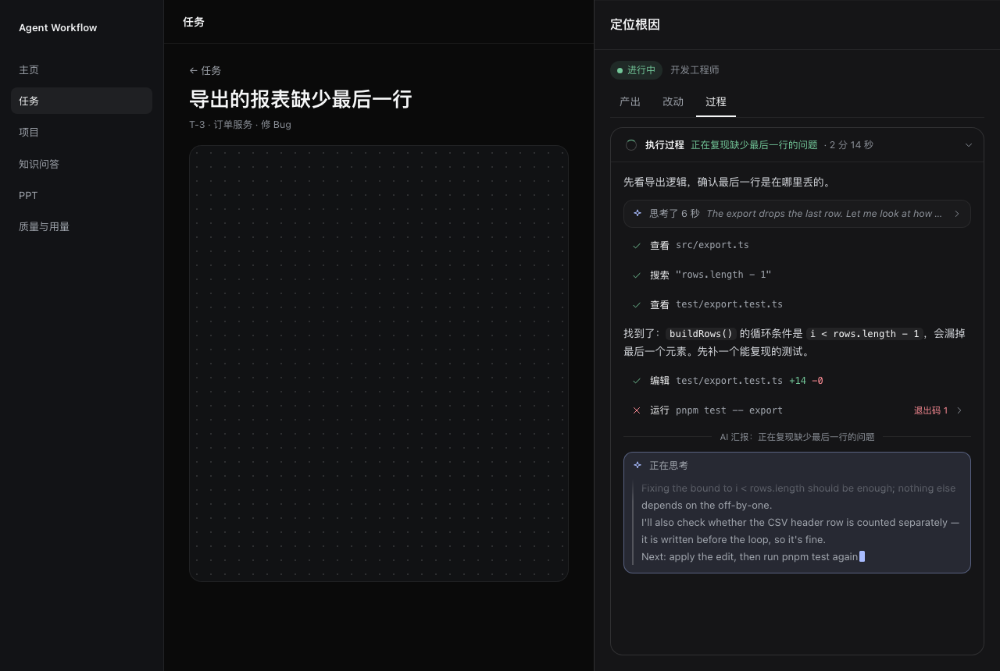 | 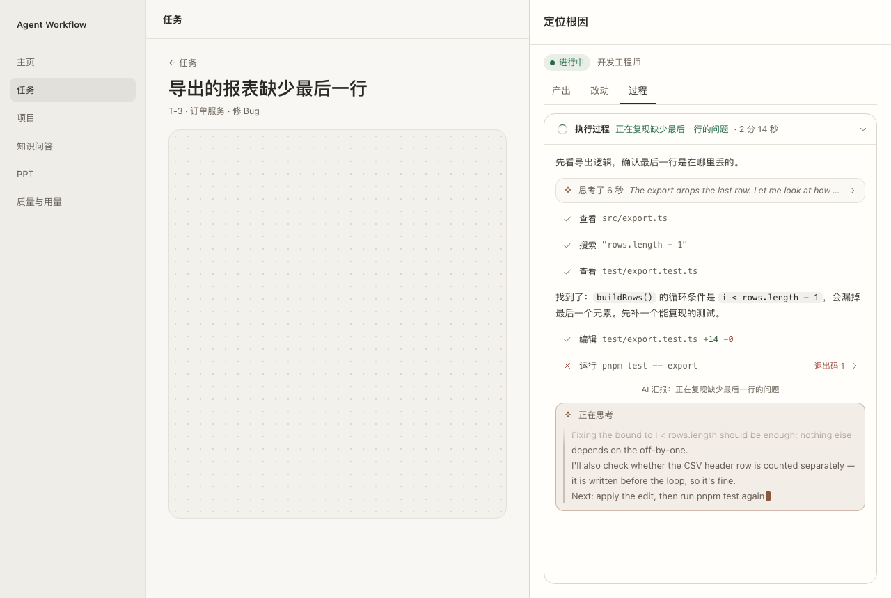 | 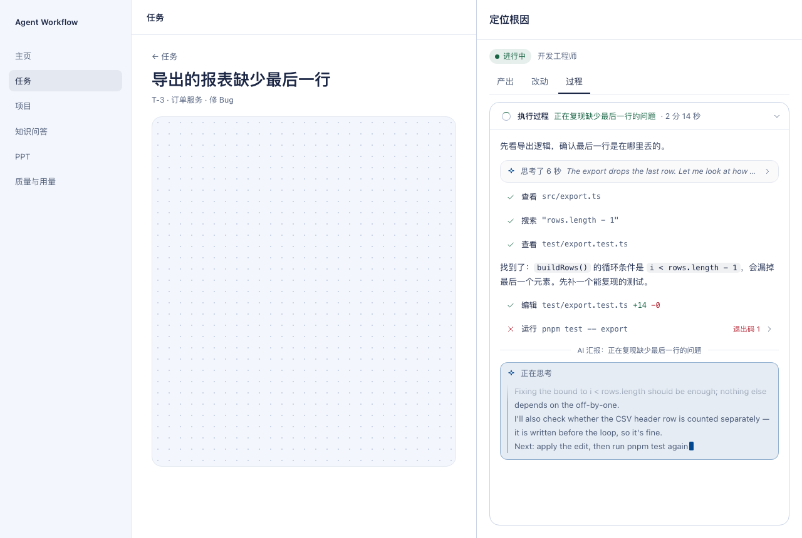 | 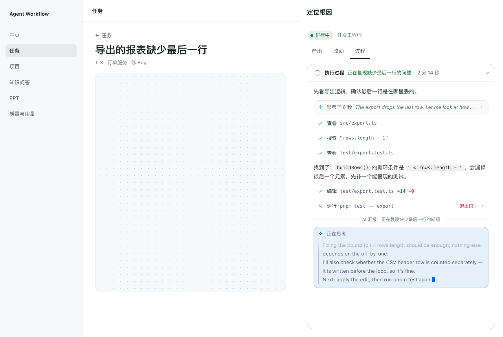 |
| 抽屉 · 结束后 | 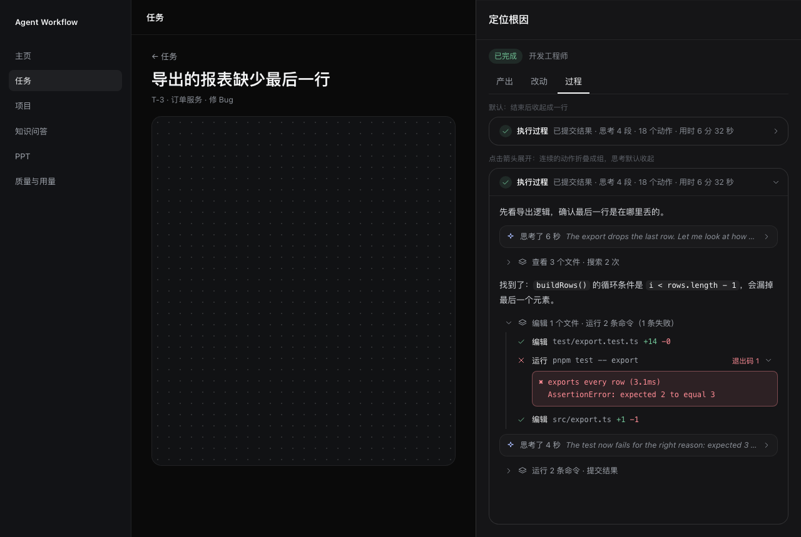 | 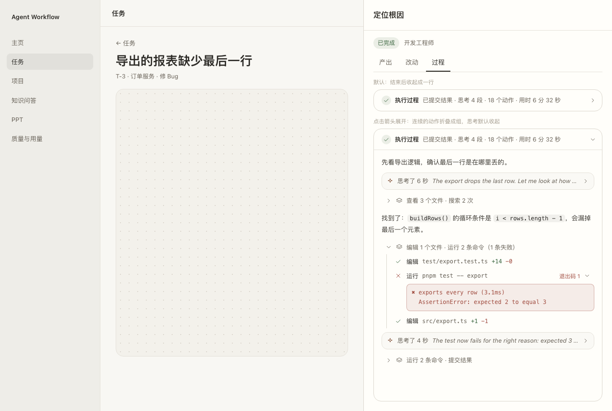 | 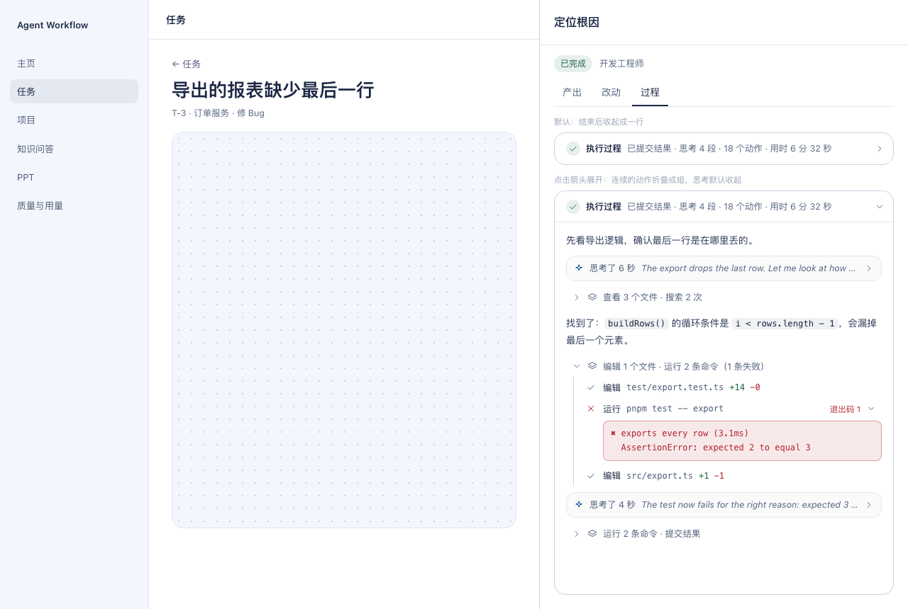 |  |
| 专业步骤页 | 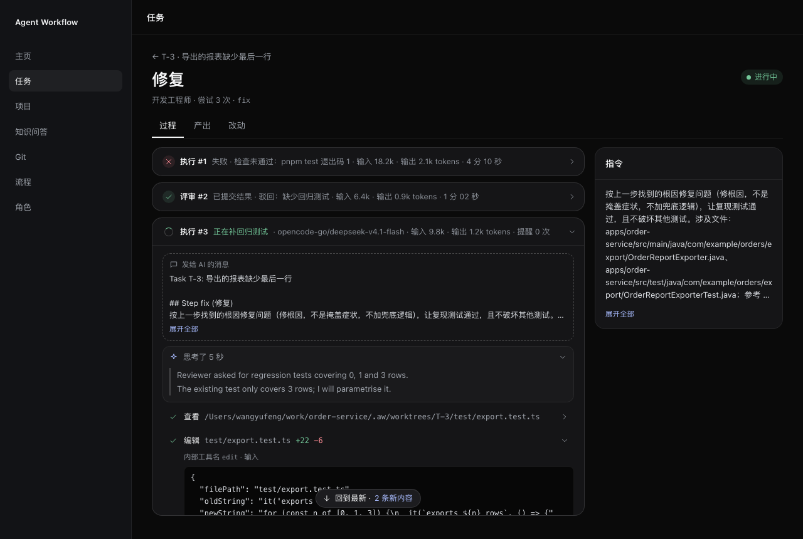 | 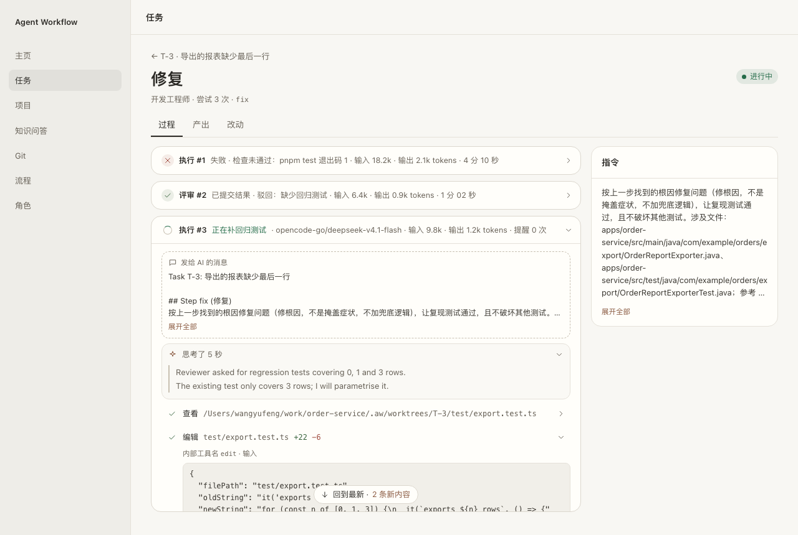 | 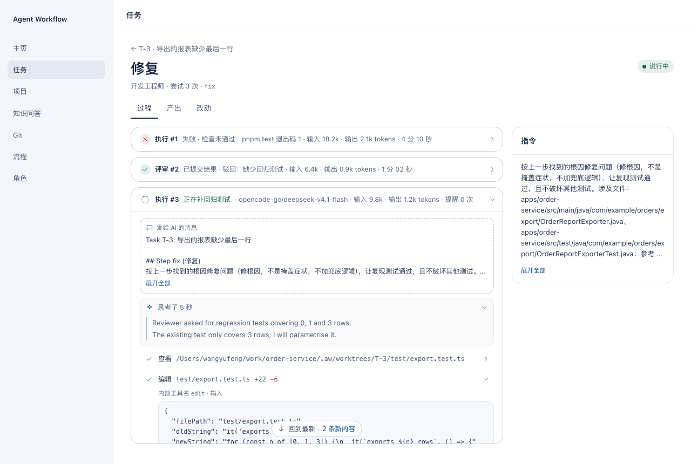 | 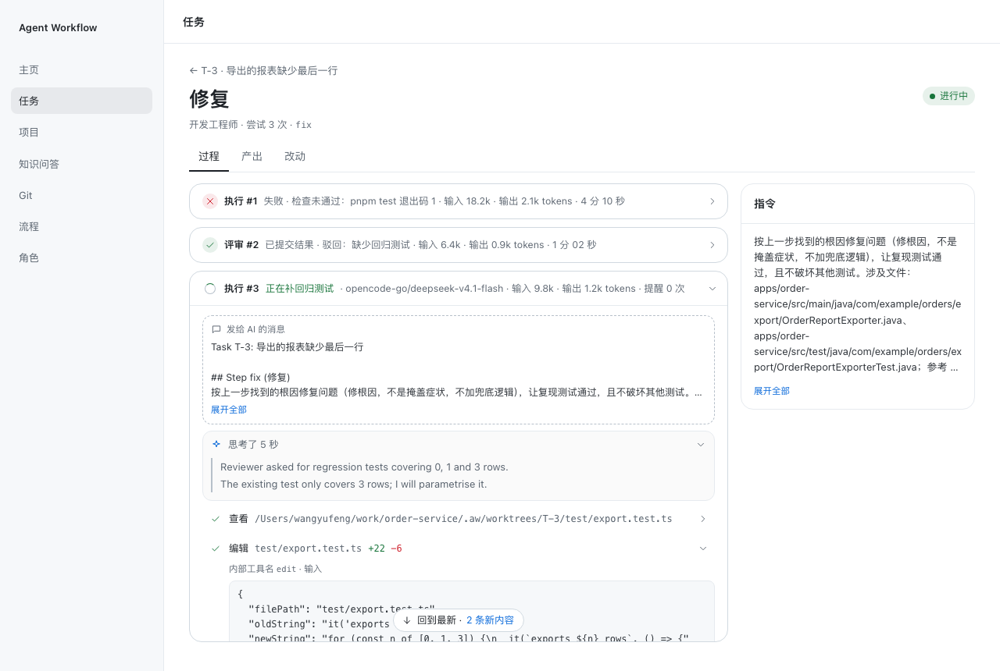 |
| 知识问答 | 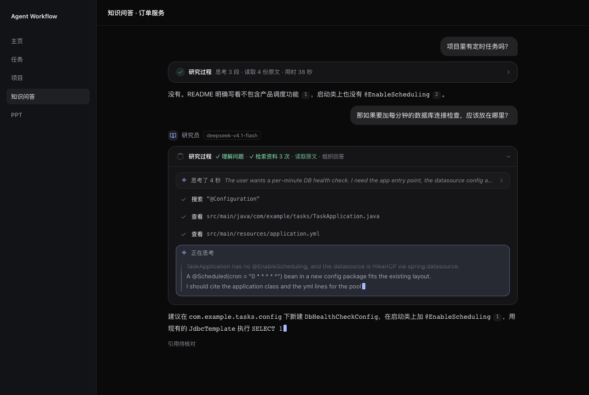 | 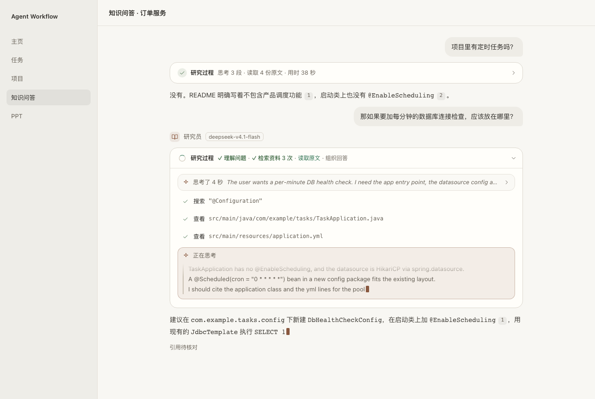 | 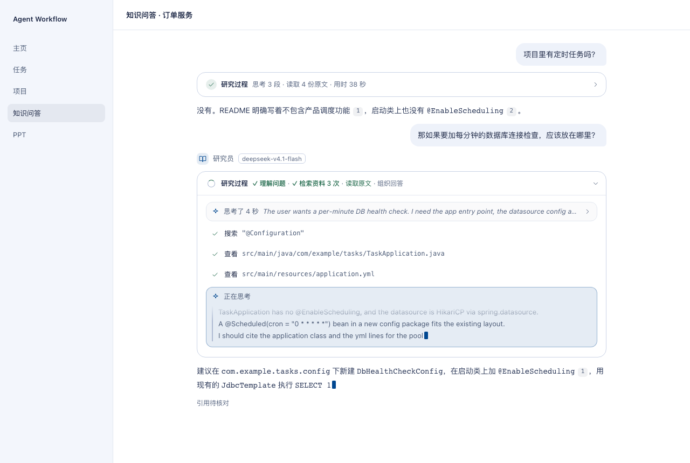 | 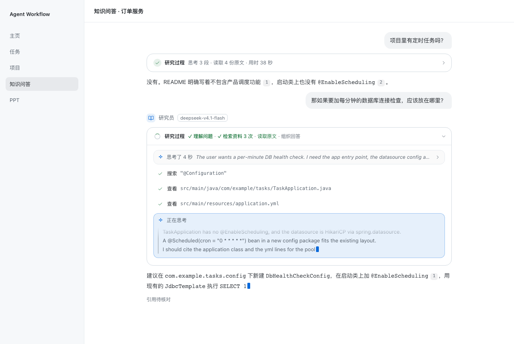 |

截图为 1280×860、`prefers-reduced-motion`（动效静止）。原型的外框（侧栏、画布、页头）只是示意，以现有页面为准；原型中两个说明小字（「默认：结束后收起成一行」等）不进入产品。
