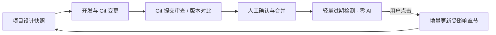

# 45 · 项目设计与 Git 审查、版本对比融合

> 状态：**已实施（Phase 1–4）**。前端交互原型见 [design/45-design-git-integration/prototype.html](design/45-design-git-integration/prototype.html)（自包含单文件，浏览器直接打开，支持 4 个核心视图与 3 套应用主题切换）；样例图：[提交审查](design/45-design-git-integration/01-git-review-dark.png) · [双版本对比](design/45-design-git-integration/02-compare-dark.png) · [增量更新](design/45-design-git-integration/03-incremental-update-light.png) · [离线报告](design/45-design-git-integration/04-offline-report-light.png)。
>
> 来源说明：基于《Agent Workflow：详细设计、提交审查与版本对比融合方案（v0.1）》精简重构，去除不适配单机桌面应用的过度防御（自研 `ArtifactEvent` 事件溯源与 CAS、多写者冲突合并、仓库内多版本发布树、提前抽象的多 Harness 与 11 实体大一统图谱），对齐本仓库既有架构与规范（[03](03-architecture.md)、[06](06-coding-standards.md)、[07](07-testing-standards.md)、[27](27-git-workbench.md)、[38](38-convergence.md)、[44](44-project-design.md)）。

打通「项目设计工作台（[44](44-project-design.md)）」与「Git 工作台提交审查 / 版本比对（[27](27-git-workbench.md)、[13 §3.6](13-builtin-workflows.md#36-version_review--版本比对审查只读d126)）」：用已沉淀的现状设计知识增强代码审查与版本对比的业务影响识别，并在代码合并后支持按 Git 变更增量更新项目设计。

---

## 1. 目标与边界

### 1.1 解决的问题

- `git diff` 只说明改了哪些代码，结合项目设计知识才能说明改动影响了哪些模块、子模块与交易链路。
- 代码缺陷（Finding）与潜在业务影响（Impact）职责不同：一段没有 Bug 的公共方法修改，依然可能影响多条交易或下游模块。
- 版本对比不应止步于文件级差异，还要能看到架构模块、交易链路与回归范围的变化。
- 代码合入后，项目设计需要按变更低成本增量维护，而不是每次全量重跑。

### 1.2 核心原则

1. **保留业务入口，不增侧栏膨胀**：遵循功能收敛约束（[38 C6](38-convergence.md#c6-收敛之后的约束防止再次膨胀)），不新增一级菜单；所有能力挂在现有的「项目设计」与「Git 工作台」中。
2. **复用现有设计数据作为知识源，不建第二套库**：直接基于 `project_designs`、`design_sections`、`design_files`、`design_diagrams` 构建轻量只读知识索引，不引入图数据库或平行知识表。
3. **复用现有单机执行与实时流**：后端为单进程权威 + SQLite 单写者，执行引擎唯一为托管 `opencode`；复用 `attempts`、`model-slots`、EventBus/SSE 与 `ConversationStream`，不自研事件溯源协议。
4. **全程只读，数据存应用 SQLite，导出显式可控**：不自动往用户项目仓库写入设计或报告文件，不自动执行 `git add / commit / push / merge`；离线 HTML 报告由用户显式导出。
5. **事实与推断分离，无知识时平滑降级**：区分 `static`（有源码证据）与 `inferred`（AI 推断）；缺失项目设计时明确提示，仍可完整运行原有审查与版本对比。

### 1.3 明确不做（YAGNI）

- 首期不建设独立代码知识图谱数据库或语言服务器（LSP）全量 AST 索引。
- 首期不提前为尚未落地的 Data / API / Lifecycle / Security / Runtime 观测源建空壳实体与抽象层，后续模块就绪时再按需接入。
- 不在进入项目或合并代码后自动静默调用 AI 更新设计（自动检测仅做零 AI 的轻量 Git 比对，更新由用户显式触发）。
- 不改造 PPT 工作台与既有任务调度器。

---

## 2. 轻量项目知识读视图与过期检测

### 2.1 只读知识投影（`ProjectKnowledgeIndex`）

在 `modules/designs` 内提供纯只读查询接口（不新增持久化表），按项目选取最近一份已就绪（或已有已完成章节）的 `project_designs` 记录，投影为内存只读索引供 `git-reviews` 消费：

| 投影元素 | 现有数据来源 | 稳定定位键 |
| --- | --- | --- |
| **章节 / 模块** | `design_sections`（`id`、`kind`、`title`、`scope_paths`） | `section.id` |
| **子模块** | `design_sections.blocks` 中 `type === 'submodule'` 项 | `sectionId + submodule.id` |
| **交易档案** | `design_sections.blocks` 中 `type === 'transaction'` 项（`code`、`channel`、`version`、`scenario`、`diagramId`、`evidence`） | `sectionId + transaction.diagramId` |
| **文件** | `design_files`（`id`、`rel_path`、`content_hash`、`section_id`） | 规范化 POSIX `rel_path` |
| **符号** | `design_files.symbols`（`id`、`qualifiedName`、`signature`、`callers`、`callees`） | `rel_path + qualifiedName` |
| **关系边** | `design_diagrams.edges`（保留 `evidenceClass: static \| inferred`、`evidencePath`、`lineStart/lineEnd`、`rationale`） | `diagramId + edge.id` |
| **快照基线** | `project_designs.source_snapshot`（`branch`、`commitSha`、`dirty`、`analyzableCount`、`skippedReasons`） | `commitSha` |

**语义约束**：
- 同一文件可被多个子模块或交易证据引用，投影层维护 `relPath -> { file, sectionIds, submoduleRefs, transactionRefs, diagramNodeRefs }` 的反向映射。
- 仅将 `blocks IS NOT NULL` 的章节纳入有效知识覆盖；若设计处于 `incomplete` 状态，在知识元信息中明确标出覆盖率（如 `已完成 4 / 6 章`），不把未覆盖区域误报为“无影响”。

### 2.2 轻量过期检测（零 AI）

由于项目设计扫描的是工作区磁盘文件并记录了 `design_files.content_hash` 与 `source_snapshot.{commitSha, dirty}`（见 `designs.scanner.ts`），不能仅靠 `git diff <snapshotSha> HEAD` 判断过期（例如快照在 `dirty === true` 时生成、之后撤销工作区修改，`HEAD` 未变但内容已变）。

新增只读操作 `designs.staleness`（`GET /designs/:id/staleness`），用于判断**设计相对当前工作区是否过期**：

1. 若设计未绑定项目或项目目录不可用，返回 `{ state: 'unknown', reason }`，不阻断页面。
2. **快速路径**：若各章共用全局基线、存在 Git，且 `source_snapshot.dirty === false`、`source_snapshot.commitSha === currentHeadSha` 且当前工作区干净（`status.clean === true`），直接返回 `state: 'fresh'`。
3. **精确比对路径**（其余情况，含章节独立基线、脏工作区、提交前进/回退及无 Git 项目）：复用 `designs.scanner.ts` 的排除规则扫描当前工作区文件哈希，与章节记录的独立哈希（如有）或 `design_files.content_hash` 比对得出新增、删除、内容变化的文件集合，再映射到受影响的 `design_sections`（命中 `design_files.section_id` 或 `scope_paths`）：
   - 无任何文件增删改 → `state: 'fresh'`；
   - 存在增删改 → `state: 'stale'`，返回 `{ baseSha, headSha, changedFilesCount, affectedSectionIds, changedPathsSample }`。
4. 进入项目设计工作台或 Git 工作台审查面板时按需调用，纯本地 IO，零模型消耗。

### 2.3 区分「工作区过期」与「版本匹配度」

在提交审查或双版本对比中，需明确区分设计快照能否代表某个目标版本 `targetSha`（`DesignKnowledgeMatch`）：

- **`exact`（精确匹配）**：仅当各章共用全局基线且 `source_snapshot.dirty === false && source_snapshot.commitSha === targetSha` 时成立，说明该设计完整对应此不可变提交，可直接用于双版本结构化对齐。
- **`reference`（参考线索）**：设计存在但来自其他提交或脏工作区（例如审查历史提交时选用项目最近一次设计）。仅作为影响初筛线索注入，界面与 prompt 均显式标明「参考设计（非当前目标版本）」，所有结论必须回到目标版本的真实源码与 Diff 核验，禁止把后来才出现的模块/交易当作该历史版本的事实。
- **`missing`（无设计）**：项目尚无可用设计，直接退回原有源码审查/对比流程。

---

## 3. 变更影响分析（两段式）

沿用现有 `git-reviews.target.ts` 的目标解析，并明确区分**区间审查（`range`）**与**双版本对比（`compare`）**：
- `commit`：固定 `<parentSha>..<sha>`（合并提交记录 1-based `parent`）；
- `branch`：固定 `<mergeBase(defaultBranch, branch)>..<branchHead>`；
- `range`：**保留现有语义不变**，固定 `<mergeBase(from, to)>..<to>`（用于分支/PR 式增量审查）；
- `compare`（新增）：**双版本端点对比**，直接固定用户选定的两个提交 `<commitOf(from)>..<commitOf(to)>`，不做 `mergeBase` 折算，确保源码 Diff、两端设计快照对齐和报告标题始终使用同一对 `(fromSha, toSha)`；
- `worktree`：固定 `HEAD` + 当前未提交文件清单（`toSha = null`），并记录启动时的变更摘要；若审查结束后工作区文件继续变动，界面提示“工作区已变化”。

### 3.1 第一段：程序初筛（有界图扩散，零 AI）

在发起 AI 审查前，服务端按优先级选择项目设计快照：优先取与目标版本 `exact` 匹配的设计（`commit`/`branch`/`range`/`compare` 优先匹配 `toSha`；`worktree` 优先匹配当前 `fresh` 设计），若无则退选最近一份已就绪设计并标记为 `reference`：

1. **直接命中**：将变更集 `files[]` 中的 `path`（含重命名旧路径）映射到 `ProjectKnowledgeIndex`，收集直接关联的 `file`、`submodule`、`section` 与 `transaction`。
2. **有界反向扩散**：沿 `design_diagrams.edges`（指向命中节点的上游调用/依赖/路由边）和 `symbols.callers` 做广度优先扩散，查找可能受影响的模块与交易：
   - 深度上限：`DESIGN_IMPACT_MAX_DEPTH = 3`；
   - 节点上限：`DESIGN_IMPACT_MAX_ITEMS = 60`；
   - 强制节点去重与环路保护；达到上限时设置 `truncated = true` 并显式告知用户与 AI。
3. **无快照降级**：若项目没有可用设计，初筛直接返回 `knowledge: null`（`match: 'missing'`），不阻断审查。

### 3.2 第二段：只读 AI 源码核验

在现有只读 `CodeReviewer` 审查会话中：
- 将初筛命中的精简上下文（快照基线、`match: exact | reference`、直接/间接候选模块与交易清单，受字节预算限制，同 `44 §4.2` 风格不超过 16 KiB）注入审查 prompt；
- 要求 AI 结合真实 `git diff` 与目标版本源码核实：
  1. 哪些候选影响确实成立（给出 `static` 源码证据或 `inferred` 推断依据）；
  2. 排除仅改注释/格式、与改动无关，或因 `reference` 快照版本不一致导致的误命中；
  3. 补充反射、依赖注入、配置项、异步消息等静态图未覆盖的 `possible` 影响项；
  4. 将**代码缺陷（`findings`）**与**业务影响（`impacts`）**分开提交，并给出面向测试/联调的**回归建议（`regression_checks`）**。

---

## 4. 提交审查工作台增强

保留 Git 工作台 `/git/:projectId` 既有入口与操作习惯（[27 §4](27-git-workbench.md#4-ai-审查d109)），升级审查结果展示与交互：

### 4.1 报告结构与页签

审查详情区提供 4 个轻量页签（代码/图表为主，辅助栏可收折）：

1. **总览**：审查目标（Commit / 分支 / 区间 / 工作区）、基线范围、结论摘要、关联项目设计快照徽标（含「已过期」提示；无设计时显示「未建立项目设计，仅基于源码审查」并提供「去新建项目设计」链接）。
2. **代码问题（Findings）**：保留原有严重级别、分类、文件行号与修复建议，新增：
   - 关联影响标签（点击定位到对应影响项）；
   - **人工处置状态**：`open`（待处理）/ `accepted`（已确认）/ `dismissed`（已忽略）/ `resolved`（已解决），修改即时落库，再次发起新审查生成新记录，**不覆盖历史人工结论**。
3. **业务影响（Impacts）**：按 `direct`（直接影响）/ `indirect`（间接影响）/ `possible`（潜在待核实）分组展示受影响的模块、子模块、交易与文件；每项标注 `静态确认` / `AI 推断`、原因、源码证据与建议检查项。当 `truncated === true` 或设计未覆盖部分目录时，顶部展示明确提示。
4. **回归建议（Regression）**：汇总可执行的回归检查清单，保留现有「据此修复」入口。

### 4.2 跨视图跳转与离线导出

- **跳源码 Diff**：点击 Finding 或 Impact 的源码证据，直接定位到本次审查对应 `fromSha..toSha` 的 Diff 位置，不误跳当前 `HEAD`。
- **跳项目设计**：当 Impact 携带 `designId` 与 `targetId` 时，点击跳转到 `/designs/:designId` 对应章节/子模块/交易或文件（若原设计已被删除，按钮置灰并提示原因）。
- **导出离线 HTML**：审查完成后提供「导出离线 HTML」按钮，复用 `designs.exporter.ts` 的零 CDN 自包含单文件/目录方案与防误覆盖检查，生成支持 `file://` 打开、含明暗主题与筛选的离线审查报告。

---

## 5. 版本对比结构化报告

保留内置流程 `version_review`（[13 §3.6](13-builtin-workflows.md#36-version_review--版本比对审查只读d126)）与现有 `range` 区间审查的向后兼容；新增明确的 `compare`（双版本端点对比）目标，在 Git 工作台提供结构化双版本对比视图：

### 5.1 两端知识对齐策略

1. **双快照精确对齐**：仅当项目存在分别与 `fromSha`、`toSha` 满足 `exact` 匹配（`dirty === false` 且 `commitSha` 一致）的两份设计快照时，程序按 `rel_path`、章节标题/路径范围、交易码+渠道+版本做实体对齐，算出结构化差异（`added` / `removed` / `modified` / `unchanged`），无法可靠对齐的重命名标为 `uncertain` 交给 AI 结合 `git diff -M fromSha toSha` 确认。
2. **单快照 / 无精确快照降级**：仅有一端精确快照、仅有 `reference` 参考快照或无快照时，基于 `git diff fromSha toSha` 做源码与业务变化分析，并在报告顶部标明两端快照的匹配状态（`exact` / `reference` / `missing`）。

### 5.2 对比视图与安全约束

- **统一端点锚定**：源码 Diff、两端设计对齐、报告标题与证据跳转严格共享同一对 `(fromSha, toSha)`，不与 `merge-base` 混用。
- **对比维度（首期）**：源码变更、架构与模块变化、交易链路变化、业务影响与回归建议（数据表与接口维度待后续独立模板落地后自然合入）。
- **无障碍标识**：新增 / 删除 / 修改 / 未变 / 待确认同时使用文字标签与符号标记，不单靠颜色区分。
- **版本源码隔离**：在对比报告中查看旧版或新版源码时，通过 `modules/git` 的 `git show <fromSha>:<path>` / `git show <toSha>:<path>` 只读获取对应版本内容，不误读当前工作区 `HEAD`。
- 支持显式导出离线 HTML 对比报告。

---

## 6. 项目设计增量更新闭环

在项目设计工作台 `/designs/:designId` 顶栏（仅当设计已确认大纲且当前无活跃运行）：

1. 检测到 `staleness.state === 'stale'` 时，显示轻量提示条：「工作区相对当前设计有 N 个文件变动，可能影响 M 个章节」，提供**「按变更增量更新」**按钮。
2. 点击后弹出确认抽屉，列出全部受影响章节（默认全选，用户可取消勾选仅先更新部分章节）以及新增/删除/修改的文件摘要。
3. 确认后执行 `designs.incrementalUpdate`：
   - **启动时冻结目标基线**：在任务启动瞬间完成一次扫描，冻结本次目标 `targetSnapshot`（`commitSha` / `dirty` / `scannedAt`）与变更文件清单，不受更新期间 `HEAD` 或工作区后续变动影响；
   - **逐章重写与回滚保护**：复用现有 `design_revise` 分片流程，逐章重跑勾选章节；每章提交前自动保存上一版到 `design_sections.previous`（支持一键「恢复上一版」），并在该章成功提交时同步更新该章关联的 `design_files.content_hash`；
   - **保守推进全局基线**：**只有当本轮全部受影响章节均被勾选且全部成功提交时**，才将全局 `project_designs.source_snapshot` 推进到启动时冻结的 `targetSnapshot` 并清理已删除文件记录；若用户仅勾选了部分章节、或中途存在失败/停止，则不推进全局 `source_snapshot`，已成功章节内容照常保留，下次过期检测基于 `content_hash` 仍会准确列出尚未更新的章节与更新期间新变动的文件，不会漏检。
4. **历史审查报告不可变**：更新项目设计只影响后续新发起的审查与对比，不修改或重写历史上已落库的 `git_reviews` 记录。

---

## 7. 数据模型、API 与 MCP 工具增补

### 7.1 SQLite 迁移

审查迁移 `0060` 与双版本对比迁移 `0061` 共同为 `git_reviews` 追加以下可空列，兼容历史记录。

| 列 | 类型 | 说明 |
| --- | --- | --- |
| `design_id` | TEXT NULL → `project_designs.id`, SET NULL | 本次审查关联的项目设计 ID；设计删除后置空，报告仍保留可读 |
| `design_snapshot_sha` | TEXT NULL | 关联设计当时的 `source_snapshot.commitSha` |
| `design_match` | TEXT NULL | `DesignKnowledgeMatch`：`exact` / `reference`（无设计时为 NULL） |
| `impacts` | TEXT(JSON) NULL | `GitImpactItemDTO[]`：业务影响列表 |
| `impact_truncated` | INTEGER(bool) NULL | 图扩散是否因深度/节点预算截断 |
| `regression_checks` | TEXT(JSON) NULL | `string[]`：回归检查建议 |
| `comparison` | TEXT(JSON) NULL | `GitComparisonDTO`：仅 `compare` 双版本端点对比使用 |

现有 `git_reviews.findings` JSON 项向后兼容扩展可选字段：`id`（缺失时读层按索引稳定回填）、`status`（缺省视为 `'open'`）、`affectedImpactIds`（可选）。

增量更新迁移 `0062` 在 `design_sections` 中增加可空的 `source_hashes`，标记共享路径在各章实际使用的版本。全量更新成功后统一清除。
`design_runs.is_incremental` 默认 false，工作台据此在刷新后为中断的增量更新提供正确的重试入口。

### 7.2 契约定义（`packages/shared/src/contracts/`）

在 `packages/shared/src/contracts/api/git.ts` 新增/扩展（严格 zod schema）：

- `gitFindingStatusSchema`：`z.enum(['open', 'accepted', 'dismissed', 'resolved'])`
- `gitImpactItemSchema`：
  - `id: string`
  - `targetKind: 'section' | 'submodule' | 'file' | 'symbol' | 'transaction'`
  - `targetId?: string`
  - `relPath?: string`
  - `title: string`
  - `classification: 'direct' | 'indirect' | 'possible'`
  - `evidenceClass: 'static' | 'inferred'`
  - `reason: string`
  - `evidencePath?: string`、`lineStart?: number`、`lineEnd?: number`
  - `suggestedChecks: string[]`
- `gitComparisonSchema`（`compare` 双版本对比可选）：`{ fromDesignId?, toDesignId?, sections: ComparisonDiffItem[], transactions: ComparisonDiffItem[], summary: string }`

在 `packages/shared/src/contracts/api/designs.ts` 新增：
- `designStalenessSchema`：`{ state: 'fresh' | 'stale' | 'unknown', reason?, baseSha?, headSha?, changedFilesCount, affectedSectionIds: string[], changedPathsSample: string[], changedFilesSample?: { relPath, kind }[] }`

### 7.3 操作清单（Operation Registry）

| Operation ID | 方法与路径 | Risk | 说明 |
| --- | --- | --- | --- |
| `designs.staleness` | `GET /designs/:id/staleness` | `read` | 零 AI 检测设计快照相对当前 Git HEAD 的过期状态 |
| `designs.incrementalUpdate` | `POST /designs/:id/incremental-update` | `write` | 按 Git 变更重扫并分片重跑勾选的受影响章节 |
| `gitReviews.updateFindingStatus` | `PATCH /git/reviews/:reviewId/findings/:findingId` | `write` | 更新单条审查问题的人工处置状态 |
| `gitReviews.export` | `POST /git/reviews/:reviewId/export` | `write` | 显式导出自包含离线 HTML 审查/对比报告 |

现有 `gitReviews.start`、`gitReviews.get`、`gitReviews.list` 路径与入参保持完全兼容（`gitReviews.start` 自动关联项目最新可用设计，无需强制传参）。

### 7.4 MCP 工具扩展（`submit_findings`）

沿用现有 `submit_findings`（[12-mcp-tools.md](12-mcp-tools.md)、[27 §4.4](27-git-workbench.md#44-mcp-工具-submit_findings)），追加可选字段：
- `impacts?: GitImpactItemInput[]`（上限 `GIT_REVIEW_IMPACTS_MAX = 60`）
- `regression_checks?: string[]`（上限 30 条）
- `comparison?: GitComparisonInput`（仅 `compare` 双版本端点对比可选）

**边界校验（`git-reviews.target.ts`）**：
- `findings` 校验沿用现有规则；
- `impacts` 中每条 `evidenceClass === 'static'` 必须携带合法 `evidencePath`（存在于仓库非排除路径内）与合法行号范围；`evidenceClass === 'inferred'` 必须提供非空 `reason`；
- 校验失败统一抛 `VALIDATION_FAILED` 返回精确 `issues`，不写库，由模型在当前会话内修正后重提。

---

## 8. 安全与内网约束

- **权限继承**：沿用 `modules/git` 只读命令白名单（`diff`、`log`、`show`、`merge-base`）与 `opencode` 只读权限，禁止任何自动写 Git 操作。
- **路径与敏感信息防护**：复用 `designs.exclusions.ts` 过滤密钥、证书、`.env*`、二进制与超大文件；所有路径规范化并拒绝目录穿越与越界符号链接（[06 §11](06-coding-standards.md#11-安全)）。
- **防注入与离线隔离**：源码文本、提交消息与 AI 输出在 Markdown 与 HTML 导出中均禁止原始 HTML 注入并做严格转义；导出 HTML 零外部 CDN 与在线字体，断网可经 `file://` 直接打开。

---

## 9. 分阶段实现与验收

### 9.1 实施顺序

| 阶段 | 范围 | 核心交付 |
| --- | --- | --- |
| **Phase 1** | 知识读视图 + 过期检测 | `designs` 只读知识索引、`designs.staleness`、项目设计顶栏过期提示条 |
| **Phase 2** | 影响分析 + 提交审查增强（MVP） | 有界图扩散、`0060` 迁移、扩展 `submit_findings`、审查报告分离展示 Findings / Impacts / Regression、人工状态持久化、跳设计节点与 Diff、离线 HTML 导出 |
| **Phase 3** | 版本对比结构化报告 | 新增 `compare` 双版本端点目标、双快照 `exact` 对齐、双版本源码只读查看、结构化对比视图与离线导出 |
| **Phase 4** | 设计增量更新闭环 | `designs.incrementalUpdate`（启动冻结目标基线 + 仅全部受影响章节成功时推进全局快照 + `previous` 回滚） |

### 9.2 测试验收清单（遵循 [07-testing-standards.md](07-testing-standards.md)）

全部使用真实 SQLite、真实临时 Git 仓库与 Fake `opencode`，禁止 `sleep`：

- [x] **兼容回归**：无项目设计快照时，`gitReviews.start`（`worktree` / `commit` / `branch` / `range`）与历史审查记录展示行为完全正常；`range` 保持 `mergeBase` 语义不变。
- [x] **过期检测与脏工作区**：在 `dirty` 状态下生成设计后撤销/修改工作区（`HEAD` 不变），`designs.staleness` 基于 `content_hash` 仍准确返回 `stale`；干净快照且 `HEAD` 未变时走快速路径返回 `fresh`。
- [x] **版本匹配区分**：仅当 `dirty === false && commitSha === targetSha` 时标为 `exact`；审查历史提交或脏快照仅标为 `reference`。
- [x] **影响传播与预算**：修改公共方法后，有界图扩散可追溯到直接与间接关联模块/交易；构造环路与超深图时正确去重并标注 `truncated: true`。
- [x] **边界校验**：`submit_findings` 提交无证据的 `static` 影响、越界路径或非法行号时返回 `VALIDATION_FAILED` 且不污染数据库。
- [x] **缺陷与影响分离及人工留痕**：无代码缺陷时仍可提交影响项；更新 Finding 状态持久化生效；重新审查生成新记录不覆盖旧审查状态。
- [x] **双版本端点对比**：分叉分支使用 `compare` 对比时，源码 Diff、两端设计对齐与 `git show` 均严格使用用户选定的 `(fromSha, toSha)`，不受 `merge-base` 或当前 `HEAD` 干扰。
- [x] **增量更新与保守基线推进**：部分勾选、停止或失败时，全局 `source_snapshot` 保留原值，已提交章节可恢复 `previous`。全选且全部成功时推进到启动时冻结的基线。更新期间 `HEAD` 前进或工作区再次编辑时，下次检测仍能识别新变动。历史 `git_reviews` 内容保持原样。
- [x] **离线导出与安全**：导出的审查/对比 HTML 不含外部资源 URL，恶意 `<script>` 提交信息/文件名正确转义，非空未知目录拒绝静默覆盖。
