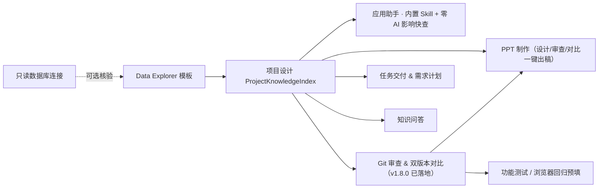

# 46 · 项目设计知识与助手、全模块联动方案

> 状态：**实施中**。前置能力（[45-design-git-integration.md](45-design-git-integration.md) Phase 1–4）已在 `v1.8.0` 全部上线。
>
> 原则对齐：遵循 [03-architecture.md](03-architecture.md)、[06-coding-standards.md](06-coding-standards.md)（不过度防御、YAGNI、一处定义）、[07-testing-standards.md](07-testing-standards.md)、[38-convergence.md](38-convergence.md)（不增侧栏膨胀）与 [41-skills.md](41-skills.md)。

将 `v1.8.0` 已沉淀的「项目设计只读知识索引（`ProjectKnowledgeIndex`）、零 AI 过期检测、两段式变更影响分析、双版本对比与增量更新」能力，以最小侵入的方式接入 **应用助手（Assistant）** 与仓库既有的 5 个核心模块（**PPT 制作**、**任务交付与需求计划**、**功能/浏览器测试**、**知识问答**、**数据库连接与模板**）。

---

## 1. 目标与边界

### 1.1 联动全景

### 1.2 核心约束与明确不做（YAGNI）

1. **零新增一级菜单**：所有联动入口均挂在现有页面页头、卡片或助手对话中，不违背功能收敛规范（[38 C6](38-convergence.md#c6-收敛之后的约束防止再次膨胀)）。
2. **零静默 AI 调用**：页面打开、任务合并、过期提示等被动触发场景一律仅走本地零 AI 计算（`designs.staleness` / `screenDesignImpact`）；任何消耗模型额度的动作必须由用户显式点击或在助手确认卡上确认。
3. **零冗余表与平行调度器**：不新建跨模块事件总线、不复制知识图谱表；复用现有 `Operation Registry`、`DeckMaterialKind`、`builtin/skills` 与 `design_templates`。
4. **守住人工决策边界**：不向助手开放 `gitReviews.updateFindingStatus`，防止 AI 替人将代码问题标为“已忽略/已解决”。

---

## 2. 助手感知与协同闭环（Phase A）

目前 `designs.staleness`、`designs.incrementalUpdate`、`gitReviews.start`（含 `compare`）、`gitReviews.get` 已在 `Operation Registry` 中标记 `assistant: true`，应用助手底层已具备调用权限，但缺少**零 AI 影响快查**和**串联这套工作流的内置 Skill**。

### 2.1 新增内置助手 Skill：`aw-design-git-review`

位于 `packages/builtin/skills/aw-design-git-review/SKILL.md`（`assistantEnabled: true`，注册进 `packages/builtin/src/skills.ts`），并在 `packages/builtin/prompts/protocol-assistant.md` 追加一句轻量触发指引：

- **查设计过期**：先调用 `designs.list` + `designs.staleness`（零 AI），向用户汇报变动文件数与受影响章节，不擅自触发更新；用户确认后再调 `designs.incrementalUpdate`。
- **查影响与发版对比**：
  - 用户问“改某个文件/符号会影响什么”且不需要完整代码审查时，先用零 AI 的 `designs.lookupImpact` 秒级给出设计图谱内的直接/间接关联模块与交易，并明确说明这是静态初筛线索（附快照匹配度）；
  - 用户要求正式审查提交、工作区或对比两个版本时，区分 `range`（从共同祖先）与 `compare`（直连双端点），调用 `gitReviews.start`，完成后读取 `gitReviews.get` 为用户提炼代码问题、业务影响与回归清单。
- **逐次确认**：助手发起 `gitReviews.start`（含双版本对比）或 `designs.incrementalUpdate` 必须先由用户确认本次操作。完全访问模式和旧的「总是允许」授权也需逐次确认。
- **串联后续动作**：审查或对比完成后，按需建议用户「据此修复」「生成发版评审 PPT」或「合入后增量更新设计」；绝不替用户修改 Finding 人工处置态。

### 2.2 新增只读操作：`designs.lookupImpact`

- **路径**：`POST /designs/:id/lookup-impact`（`OperationRisk.Read`，`expose: { palette: false, assistant: true }`）
- **入参**：`{ id: string, paths: string[] }`（上限 50 条项目相对路径）
- **行为**：纯内存复用现有 `buildProjectKnowledgeIndex` + `screenDesignImpact`（零 AI、深度 3 / 上限 60 / 环路保护），返回 `{ designId, snapshotSha, dirty, coverage, candidates, uncoveredPaths, truncated }`。
- **价值**：让助手在聊天里秒级回答“改这几个文件会波及哪些模块和交易？”，不消耗额外审查会话。

### 2.3 助手按需导出离线报告（可选）

- 如需支持对助手说“把刚才那份审查报告导出到桌面目录”，可将 `gitReviews.export` 开放 `assistant: true`（沿用 `designs.export` 规则：非空未知目录覆盖需逐次确认，绝不静默覆盖）。

---

## 3. 联动 PPT 制作（Phase B）

复用现有 PPT 素材快照架构（[23-ppt.md](23-ppt.md)、`packages/server/src/modules/decks/decks.materials.ts`）：

### 3.1 扩展 `DeckMaterialKind`

在 `packages/shared/src/enums/deck.ts` 追加两项：
- `Design: 'design'`：从指定 `project_designs` 抽取精简结构化文本快照（标题、基线、各已完成章节摘要、子模块职责、交易清单与关键关系边），按现有 `DECK_MATERIALS_MAX_CHARS` 截断。
- `GitReview: 'git_review'`：从指定已完成 `git_reviews`（含 `compare` 双版本对比）抽取文本快照（目标范围与两端 SHA、结论摘要、重点代码问题、分组业务影响、架构/交易对比差异与回归建议）。

创建 PPT 时即冻结素材文本（同现有 `Task` / `Artifact` / `Knowledge` 素材规则），后续设计更新不影响已生成的 PPT。

### 3.2 入口与助手协同

- **界面入口**：
  - 项目设计工作台顶栏「更多」菜单增加 **「生成 PPT」**（仅存在已完成章节时可用），跳转 `/decks/new` 并预填 `material = { kind: 'design', refId: design.id }` 与默认主题提示（「架构/交易设计汇报」）；
  - Git 审查与双版本对比报告页头增加 **「生成 PPT」**（仅已成功报告可用），跳转 `/decks/new` 并预填 `material = { kind: 'git_review', refId: review.id }`（例如「版本变更评审 / 影响评估 PPT」）。
- **助手直通**：`decks.create` 本身已开放给助手，用户直接说*「把刚才 `v1.7.5` 到 `v1.8.0` 的对比报告做成一页 8 页的发版评审 PPT」*即可一键起草大纲。

---

## 4. 联动任务交付、需求计划与功能测试（Phase C）

### 4.1 任务交付卡（Delivery）零 AI 影响预览与合入提醒

- **交付前（零 AI）**：在任务详情交付区查看任务 worktree Diff 时，新增轻量只读查询 `tasks.designImpact`（复用 `screenDesignImpact`，零 AI、不新增表），若该项目存在已就绪设计，在交付卡折叠区展示「设计影响初筛：命中 M 个模块 / K 条交易（`exact`/`reference`）」，支持点击跳项目设计节点，帮助合并前最后把关。
- **合并后（零 AI）**：任务合并进主分支成功后，若项目存在已就绪设计，调用一次 `designs.staleness`，若返回 `stale` 则在交付完成卡上展示一条轻量提示：「项目设计有 N 个文件变动（影响 M 章）· [打开项目设计去增量更新]」，不自动启动 AI。

### 4.2 需求计划（Initiatives）与详细设计（`detailed_design`）注入知识摘要

- 在需求拆解（`initiatives`）或内置 `detailed_design` 流程启动时，若目标项目存在已就绪设计，按 16 KiB 预算注入精简 `ProjectKnowledgeIndex` 目录摘要（章节、子模块、交易清单与基线 SHA，标明 `exact`/`reference`），帮助 AI 更准确拆解工作包与识别已有交易边界；无设计时完全保持原行为。

### 4.3 审查/对比回归建议 → 一键发起回归测试

- 沿用 Git 审查现有 **「据此修复」** 的零耦合预填模式（[27 §4.6](27-git-workbench.md#46-据此修复)）：
- 在 Git 审查与双版本对比的 **「回归建议」** 页签增加 **「据此发起测试」** 按钮：将勾选的 `regressionChecks`、关联受影响交易与变更范围预填为新建功能测试任务（`functional_test`）的需求说明，由用户确认后启动执行，不新增后端耦合表。

---

## 5. 联动知识问答（Phase D）

复用现有 `packages/server/src/modules/knowledge/knowledge.task-material.ts` 的只读上下文接入方式：

- 在绑定项目的知识问答会话中，当项目存在已就绪设计时，自动在首轮上下文中附带精简的项目设计索引（章节/模块/交易/依赖摘要及快照基线，受字节上限约束）；
- 研究员仍以真实源码为准核验回答，但能秒级定位目标模块与交易入口，回答*「某公共方法被哪些交易调用」「某笔交易的异常出口在哪」*时引用更准、扫描更快。

---

## 6. 联动数据库模块 → `data-explorer` 内置设计模板（Phase E）

遵循 [44 §5.4](44-project-design.md#54-内置分析模板与阅读风格) 的「模板即数据配置」原则，不引入新执行引擎：

- 在 `packages/builtin/` 新增内置只读项目设计模板 **`data-explorer`（数据模型与 SQL 链路探索）**，预设章节蓝图：数据架构总览 → 核心实体与表结构 → SQL 读写与映射热点 → 事务边界与迁移风险。
- **可选联动只读数据库**：若目标项目已配置只读数据库连接（[24-databases.md](24-databases.md)），分析员可复用既有 `aw-db-readonly` 只读能力核验真实表结构、主键与索引（严禁写操作、严禁读取真实业务敏感行数据）；未配置数据库时纯基于仓库迁移脚本、DDL、ORM 实体与 Mapper/SQL 源码分析。
- **自然穿透影响分析**：产出的表/SQL 章节与关系边沿用既有 `DesignBlock` 与 `DesignDiagramEdge`（带 `evidencePath` 与行号），自动进入 `ProjectKnowledgeIndex`，使 Git 审查与双版本对比无需改动引擎即可追踪「改迁移/表字段 → 受影响 SQL → 关联服务与交易」。

---

## 7. 分阶段实施顺序与验收清单

五个阶段依次在本地分支 `codex/design-ecosystem-integration` 实施，各自通过专项验证并独立提交。最终提交在干净检出上运行 `pnpm verify` 和浏览器回归，供 Brain 评审。

| 阶段 | 范围 | 核心交付 | 依赖迁移 |
| --- | --- | --- | --- |
| **Phase A** | 助手联动闭环 | `aw-design-git-review` 内置 Skill、`protocol-assistant.md` 触发指引、`designs.lookupImpact` 零 AI 快查 | 无 |
| **Phase B** | PPT 素材联动 | `DeckMaterialKind` 新增 `design` / `git_review`、`decks.materials.ts` 快照提取、设计/审查页「生成 PPT」入口 | 无（JSON/TEXT 枚举兼容） |
| **Phase C** | 任务交付 & 测试联动 | 交付卡零 AI 影响初筛与合入过期提示、需求拆解/详细设计知识摘要注入、回归建议「据此发起测试」预填 | 无 |
| **Phase D** | 知识问答联动 | 知识问答接入精简项目设计索引摘要 | 无 |
| **Phase E** | `data-explorer` 模板 | 内置只读模板 `data-explorer` + 可选只读数据库结构核验 + 影响分析自动穿透表/SQL | 无 |

### 验收重点（遵循 [07-testing-standards.md](07-testing-standards.md)）

- [x] **Phase A**：助手在只读场景下调用 `designs.staleness` / `designs.lookupImpact` 不弹写确认；发起 `compare` 或 `incrementalUpdate` 正确走确认卡；助手无法调用 `gitReviews.updateFindingStatus`。
- [ ] **Phase B**：从项目设计与双版本对比报告均可一键创建 PPT，生成后更新项目设计不影响已冻结的 PPT 素材内容。
- [ ] **Phase C**：任务交付页展示零 AI 影响初筛且不消耗模型额度；合入后展示过期提示且不自动触发 AI；回归建议预填功能测试任务可正常启动。
- [ ] **Phase D**：绑定项目的知识问答在存在设计时注入受控预算摘要，无设计时行为不变。
- [ ] **Phase E**：`data-explorer` 在有/无只读数据库连接两种环境下均可正常生成设计，修改 DDL/SQL 后 Git 审查能追溯到受影响表与交易。
