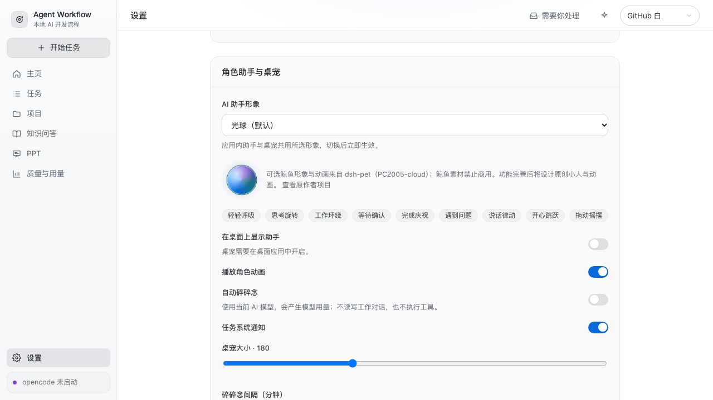
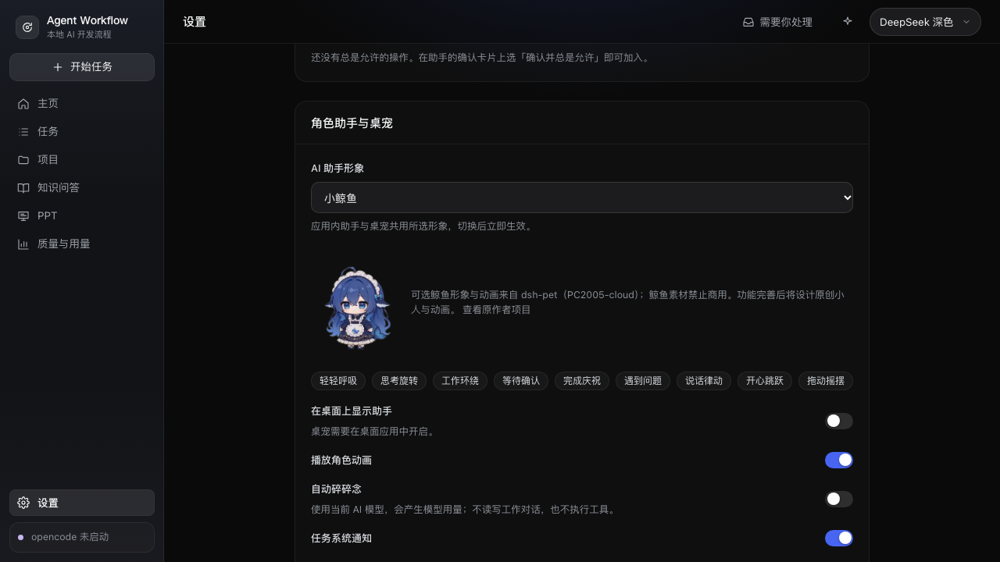

# 角色助手与桌宠 · 首版开发和验证记录

2026-10-23，分支 `codex/whale-assistant`，初始基线 `main@d3335a6352f076189ea006e5c42251035d75ceda`。实现位于独立工作树。阶段设计先于代码编写，见 [32](../32-companion-assistant.md)。以下首版验收完成后，用户要求创建 PR、合入 main 并安装到本机测试；交付前另同步了浏览器 B1 的 `main@c54c2c0`，保留两边的设置、窗口接口与文档。

## 本轮结果

- 设置新增形象选择，**默认保留原有光球**，鲸鱼可选，应用内和桌宠即时同步。光球使用原渐变，补充呼吸、旋转、工作环绕、等待、庆祝、错误、说话和互动动作；设置页可预览，系统减少动态效果和动画开关均生效。
- 固定上游提交导入 106 段鲸鱼 WebM，每个文件核对 Git blob SHA，来源清单另外记录 SHA-256。保留来源和非商用约束。原创小人和动画仍在功能完善后的 W6。
- 桌宠使用同一 Electron、preload 和后端，透明置顶，支持拖动、动作菜单、聊天、主窗口隐藏／恢复、托盘和退出。窗口位置恢复到合法工作区。
- 聊天复用现有会话、流式消息、确认卡片和停止等能力；跨窗口共享选中会话。桌面消息以 `desktop` 为上下文，主窗口不会被导航成桌宠。
- 碎碎念使用独立 `aw-companion` 会话，全工具 deny，完成／取消后删除。自动默认关闭，按设置间隔生成；聊天、工作或通知期间静默。最多 120 字符、60 秒，气泡 12 秒后收起。
- 任务 `review`、`completed`、`failed` 和阻塞条目驱动提醒；待检查与完成文案不同，多条排队，进度更新不重复。只有主窗口申请系统通知。

## 验证结果

| 验证 | 结果与含义 |
| --- | --- |
| `pnpm verify` | 通过：类型、Biome、依赖边界、CSS、状态机文档同步、单元、集成与生产构建 |
| 单元 | 681 通过，包括通知去重／重新执行／快照对齐、窗口工作区夹取 |
| 集成 | 278 通过，1 个数据库 INCLUDE 列适用性条件用例跳过；真实 SQLite、Git 与数据库；模型部分为 FakeOpencode |
| 核心浏览器旅程 | 修正后 39/39 通过，覆盖原助手任务／确认／导航／交付，以及新形象切换、视频播放、减少动态效果、失败提示、桌宠对话与任务通知 |
| 自动碎碎念浏览器 | 1/1 通过；可控时钟推进，不使用 sleep；间隔触发、聊天静默、关闭后停止调用模型 |
| 四主题完整走查 | DeepSeek、暖色、SPDB、GitHub 白 4/4 通过；两种模式的页面、报错、对比度和横向溢出 |
| 真实 Electron | 3/3 通过：启动冒烟；桌宠窗口沙盒、默认光球、会话／形象同步、拖动、主窗隐藏／恢复、关闭桌宠和退出；真实隐藏窗口 PDF 导出及错误路径 |
| 最后改动复验 | 辅助窗口隔离与桌宠面板布局调整后，`pnpm check`、`pnpm build` 和 4 项桌宠浏览器用例通过；原生窗口隔离另经上述 3 项 Electron 用例验证 |
| 真实模型 | `opencode-go/deepseek-v4.1-flash`：碎碎念返回「今天想喝杯热可可，甜甜的那种。」；独立 `desktop` 来源助手消息返回「桌宠对话已连通。」；工作聊天未混入碎碎念。此项证明真实后端模型链路，不等同于全流程真实模型桌面任务验收 |

测试日志与代表性截图保存在本目录的 `companion-evidence/`。构建沿用仓库已有的大块提示，没有新增运行时依赖。

### 同步浏览器 B1 后的交付复验

在 `main@c54c2c0` 上保留桌宠与浏览器两组设置、共享 preload 接口和安全说明，解决 5 个文件的合并冲突后复验：

- `pnpm verify` 通过：706 项单元、306 项集成通过，1 项数据库条件用例跳过；类型、规范、依赖边界、CSS、状态机文档和生产构建均通过。
- 核心浏览器旅程 43/43 通过，包括自动碎碎念、桌宠以及新主线的网站规则与预览设置。
- 真实 Electron 6/6 通过，包括 3 项浏览器宿主用例，以及桌宠、启动、PDF 导出。
- 以上日志为 `merge-verify.txt`、`merge-browser.txt`、`merge-electron.txt`。四主题与真实模型证据仍为前述首版验收，不将其称作本次重复执行的结果。

## 验证中修正的问题

1. 拖动起点原先读取系统当前鼠标，移动读取 renderer 事件；两次读取时刻可能不同。改为起点和移动都来自同一类事件屏幕坐标，真实 Electron 拖动用例通过。
2. 退出时必须先取消并删除碎碎念会话，再关闭 opencode；新增退出期间在途生成的集成用例。
3. 既有助手 E2E 为观察忙碌状态留下两项挂起任务，整套运行占用后续并发测试槽位；测试结束按自身临时项目清理，未改调度上限或削弱并发断言。
4. 首轮两个 Playwright 进程共用报告目录，产生 trace 文件冲突；后续各自使用独立输出目录。首轮全套记录为 39 通过、4 失败，不能称作该轮全绿；修正后相关 13 项复验、全部 39 项核心旅程以及自动计时用例均通过，四主题走查原轮全部通过。
5. 减少动态效果测试区分角色 CSS 动画和主题颜色过渡；结束提醒后的形象回到实际工作状态，不能假定共享后端没有其他运行任务。
6. PDF 导出的隐藏窗口也会加载应用页面。preload 现在明确区分主窗口、桌宠与辅助窗口；辅助窗口不配置桌宠、不接管会话选择或产生桌宠通知。真实 PDF 导出回归通过。
7. 聊天、菜单或通知展开时收紧桌宠显示尺寸，防止大尺寸角色挤压交互面板；右键和键盘菜单关闭聊天后展开动作列表。

## 后续验收边界

- 本机 macOS 通过上述自动验证。真实鼠标点击透明区域穿透、显示器拔插、操作系统通知授权、Windows/Linux 的托盘／置顶行为尚未人工或跨平台验收。
- 快照重连对齐当前状态，不恢复缓冲丢失期间每一个中间转换；窗口提醒队列各自已读，应用退出期间不承诺后台运行。
- 原创小人和动画尚未制作，按用户确定的 W6 路线执行；鲸鱼是可选临时开发素材，光球保持默认。

