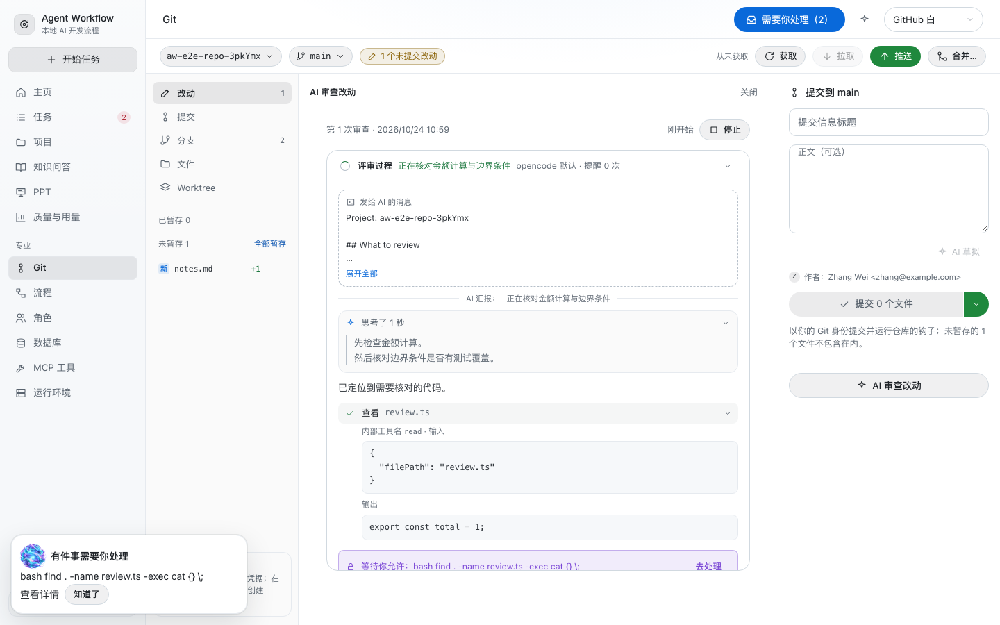
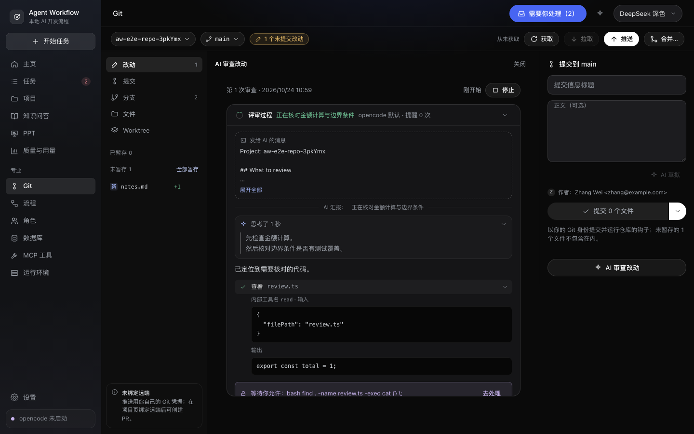

# GW-08 权限同步与 AI 审查过程 · 2026-10-24

## 问题与根因

根因：opencode 的「总是允许」会自动完成同时等待、规则匹配的其他请求，并分别发送 `permission.replied`。应用原来只处理 `permission.asked` 和用户点击后收到的 HTTP 返回，遗漏原生完成事件，导致已结束的请求仍留在「需要你处理」。再次点击时原生返回 `PermissionNotFoundError`，又被转换为泛化的通信失败。

Git 审查已经有尝试、会话记录和 SSE，但 DTO 未暴露尝试 ID，界面仅显示「正在审查」。任务简单视图也只选执行尝试，遗漏随后运行的 AI 评审；差异范围审查启动后仅弹出提示，未打开过程。

## 本次行为

- 按尝试与权限请求 ID 同步原生完成事件；SSE / HTTP 任意先后与重复事件只关闭一次。仍在等待的其他请求继续保留。
- 只有原生明确确认同一权限请求已不存在，才将残留条目标为失效，返回 `PERMISSION_REQUEST_EXPIRED`；不补记批准规则。其他连接、404 或服务器故障仍显性报错。
- 应用助手同步清理自动完成的权限；只在最后一条请求结束后恢复使用时长计时。
- Git 工作区、提交、分支、差异范围四个入口共用设计 25 的会话流；任务当前步骤、简单过程页及专业尝试页均可查看评审。
- 展示实际进展、耗时、正文、模型提供的思考与工具输入输出；固定高度内滚动，结束后收起。刷新、切换历史、重新审查与停止后保留对应记录。
- Git 审查的权限卡片来源由错误的「PPT」改为「Git 审查」。

无数据库迁移，无新增依赖，不改变项目已有的 bash 批准规则范围。

## 验证

权限事件与集成回归先失败，完成修复后通过。浏览器第一次全量走查发现旧定位器假设只有一条过程；更新为分别验证执行与评审两条折叠记录后重新验证。后续单批运行的后两个主题在 Git 总览加载超时：Trace 显示页面正在读取前面用例累计的 61 / 71 个项目，5 秒断言结束时仍有请求排队。新增用例改为结束后移除自身项目；最终将功能用例与主题走查放在独立后端分批执行，未修改断言时限、增加重试或跳过用例。

| 检查 | 结果 |
| --- | --- |
| `pnpm check` | 类型、Biome、模块依赖、CSS、状态机文档检查通过 |
| `pnpm test` | 62 文件，742 项通过 |
| `pnpm test:int` | 67 文件，394 项通过，1 项已有数据库环境条件跳过 |
| `pnpm build` | 桌面主进程、preload、renderer 与生产包依赖检查通过 |
| `pnpm test:oc` | 5 文件，11 项通过 |
| 浏览器 E2E（独立后端分批） | 60 项功能用例 + 4 项主题走查全部通过；每主题 81 个页面，无对比度或横向溢出问题 |
| 完整 Electron E2E | 14 项通过，含真实模型修 Bug、执行中退出与重启后恢复 |

新增回归覆盖原生并行 `find` 请求被「总是允许」自动完成、明确失效与普通故障的区分、SSE 先于 HTTP、事件重放、无关条目保留、项目批准规则不被扩展、助手同步，以及四类 Git 审查和任务评审的显示与历史切换。

浏览器最终执行命令：`pnpm exec playwright test --project=browser --grep-invert=@walkthrough`（60 项，3.0 分钟），随后 `pnpm exec playwright test --project=browser --grep=@walkthrough`（4 项，4.8 分钟）。Electron 完整 14 项耗时 2.2 分钟。分批仅隔离测试数据；项目较多时 Git 总览的载入性能不在本次修复范围内。

原生权限用例使用真实 opencode 与本地脚本模型；浏览器截图使用 FakeOpencode 提供可重复的过程，不能据此推断模型审查结论质量。验证平台为本机 macOS；未执行 Windows / Linux 真机验收，GitHub CI 按仓库约定仅手动触发。

## 界面证据

GitHub 白：

DeepSeek 深色：

